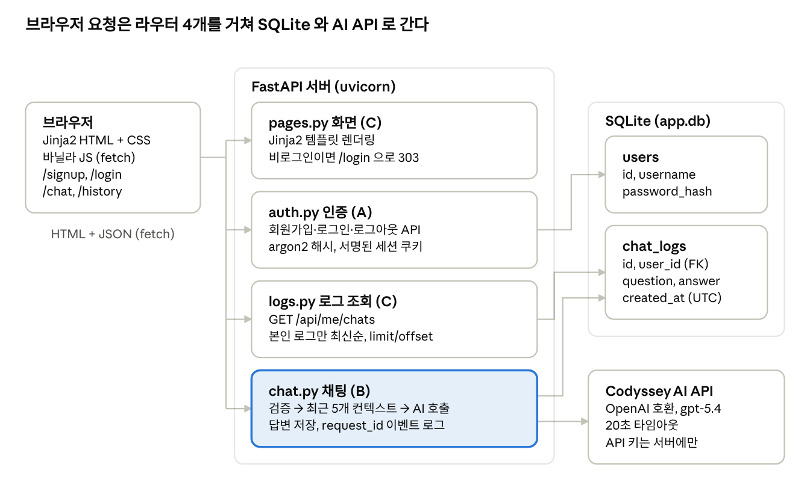

# Codyssey AI 챗봇 퍼실 문답 예상 Q&A

작성 @ADOHI (Claude Code 사용) · 2026-10-12 갱신

> 발표 준비용으로 작성한 문서입니다. 2026-10-12 에 그날 바뀐 내용(B 의 오류 처리 수정, 지난 대화 전체 보기, 동시 접속 분석, 협업 규칙 문서 정정)을 반영해 다시 고쳤습니다. 커밋·PR·테스트 수는 커밋 `57f81d2` 기준이며, 이 문서를 고친 PR 은 세지 않았습니다. 바뀐 내용의 요약은 [12절](#12-2026-10-12-에-바뀐-것)에 있습니다.

과제 문서(웹 기반 AI 챗봇 서비스 개발 프로젝트)와 저장소 구현을 기준으로, 퍼실리테이터 문답에서 나올 만한 질문과 모범 답변을 정리한 문서입니다. 팀원 3명(A @junhnno, B @Wattamelon, C @ADOHI)이 함께 보며 준비하는 용도입니다.

## 1. 문답 준비 요령

퍼실 질문의 뼈대는 과제 문서 "3. 과제 목표"의 여섯 문장입니다. 각 문장이 "\~를 설명할 수 있다"로 끝나므로, 그대로 "\~를 설명해 보세요"가 질문이 됩니다. 아래 표의 절을 역할별로 먼저 준비하고, 전체 흐름(2절)은 세 명 모두 1분 안에 말할 수 있어야 합니다.

| 과제 목표 (문서 원문 요지) | 주 답변자 | 이 문서의 절 |
| --- | --- | --- |
| FastAPI 로 웹 서비스(라우팅, 요청/응답, 템플릿·프론트 연동)를 구성하는 흐름 | C | 3절 |
| 회원가입/로그인과 인증 상태에 따른 접근 제어를 적용한 이유와 방식 | A | 4절 |
| "질문 수신 → AI API 호출 → 응답 반환 → 대화 로그 저장" 파이프라인 | B | 5절, 6절 |
| 대화 로그를 DB 에 누적 저장하고 사용자 기준으로 조회/추적 가능하게 만든 설계 | A·C | 6절 |
| AI 실패/타임아웃에서 서비스가 죽지 않게 처리하고 로그로 원인을 추적하는 방법 | B | 7절 |
| 브랜치 전략, PR 기반 협업, 문서화로 팀 개발 품질을 유지하는 방법 | 전원 | 9절 |

**답변 공식**: 결론 한 문장 → 어디에 어떻게 구현했는지(파일·함수 이름) → 왜 그렇게 했는지(대안과 비교) → 보여 줄 수 있는 것(화면, 로그, 테스트). 네 번째까지 가면 질문이 끝납니다.

**금지 사항**: 모르는 것을 지어내지 않습니다. "그 부분은 B 담당인데, 제가 아는 범위에서는 \~입니다"가 정답입니다. 10절의 한계는 먼저 인정하고 개선 방향을 붙입니다.

**준비물**

- [ ] 배포 URL 접속 확인 (Render 무료 플랜은 잠들어 있으므로 문답 10분 전에 한 번 열어 깨우기)
- [ ] 로컬 서버 `uvicorn app.main:app --reload` 를 띄운 터미널 (이벤트 로그가 보이는 창)
- [ ] 계정 2개 (사용자 기준 로그 분리용. 배포 환경은 15분 미사용 시 초기화되므로 문답 직전에 가입)
- [ ] `python scripts/check_logs.py app.db` 실행 결과
- [ ] GitHub PR 목록, 이슈 목록, `git log --oneline --graph` 화면
- [ ] README 를 다른 탭에 열어 두기 (ERD, API 표, 요구사항 대응표를 바로 가리킬 수 있게)

## 2. 프로젝트 개요와 아키텍처 (전원)

이 절은 누가 받더라도 답할 수 있어야 하는 기본 질문입니다. 1분 설명은 "로그인한 사용자가 질문하면 FastAPI 서버가 최근 대화 5개를 붙여 AI API 를 부르고, 답변을 화면에 돌려주면서 SQLite 에 저장한다. 저장된 로그는 사용자별로 다시 조회할 수 있다"입니다.

**Q. 이 서비스는 무엇을 해결하는 서비스인가요? 타겟 사용자는 누구인가요?**

로그인한 사용자가 웹 화면에서 AI 에게 질문하고 대화 기록을 남기는 서비스입니다. 과제의 취지대로 리눅스·웹·DB·AI API 를 한 흐름으로 연결하는 것이 목표였습니다. 사용자는 두 부류입니다. 질문하는 일반 사용자와, 로그로 처리 과정을 추적하고 DB 를 확인하는 운영자(평가자)입니다.

**Q. 전체 구조를 설명해 보세요.**

세 층입니다. 브라우저는 Jinja2 로 그린 HTML 과 바닐라 JS 입니다. FastAPI 서버는 라우터 4개(화면 `pages`, 인증 `auth`, 채팅 `chat`, 로그 `logs`)와 AI 클라이언트, 컨텍스트, 로깅 모듈로 나뉩니다. 저장소는 SQLite 파일 하나에 `users`, `chat_logs` 두 테이블입니다. 외부는 Codyssey 가 제공하는 OpenAI 호환 API 하나입니다. 아래 그림을 가리키면서 말하면 됩니다.

강조된 `chat.py` 가 과제 목표의 핵심 파이프라인이고, 상자 이름의 (A)(B)(C) 가 담당자입니다. 브라우저는 AI API 와 직접 통신하지 않고 서버만 키를 가집니다.

**Q. 요청 하나가 처리되는 흐름을 순서대로 말해 보세요.**

1. 브라우저 `chat.js` 가 `POST /api/chat` 에 `{"message": "..."}` 를 세션 쿠키와 함께 보냅니다.
2. `get_current_user` 의존성이 쿠키의 `user_id` 로 사용자를 찾습니다. 없으면 401 입니다.
3. `request_id` 를 만들고 `request_received` 로그를 남깁니다. 빈 입력과 2,000자 초과는 400 으로 끝냅니다.
4. `context.py` 가 이 사용자의 최근 대화 5개를 읽어 메시지 목록을 만듭니다.
5. `ai_client.py` 가 20초 타임아웃으로 AI API 를 호출합니다. `ai_call_start`, `ai_call_success`(또는 `ai_call_fail`) 로그가 남습니다.
6. 성공하면 `chat_logs` 에 저장하고 `db_save_success` 로그를 남긴 뒤 `{"answer", "chat_id"}` 를 돌려줍니다.
7. `chat.js` 가 답변을 말풍선으로 같은 화면에 붙입니다.

**Q. 왜 FastAPI 와 SQLite 를 썼나요?**

과제가 Python 과 FastAPI 를 지정했고 SQLite 를 권장했습니다. FastAPI 는 의존성 주입(`Depends`)으로 로그인 확인·DB 세션·AI 클라이언트를 라우터에 꽂기 쉬워 세 사람이 파일을 나눠 작업하기 좋았습니다. SQLite 는 파일 하나라 설치가 없고 평가자가 `sqlite3` 나 스크립트로 바로 열어 볼 수 있습니다. 한계는 10절에 있습니다.

**Q. 세 명이 어떻게 나눠 만들었나요?**

파일 소유를 겹치지 않게 나눴습니다. A 는 앱 뼈대·DB·인증, B 는 AI 호출·컨텍스트·로깅·예외, C 는 화면·로그 조회·배포·문서입니다. 첫날 인터페이스 세 개(`get_current_user`, `ChatLog` 모델, `POST /api/chat` 요청·응답 형식)를 합의해 두고 병렬로 작업했고, 그 덕에 머지된 PR 34개에서 충돌이 한 번도 없었습니다.

## 3. FastAPI 웹 서비스 구성 (C)

핵심은 "화면은 템플릿이 그리고, 데이터는 JSON API 가 처리하며, 둘을 브라우저의 fetch 가 잇는다"입니다. 요구사항 1(웹 UI)과 과제 목표 첫 번째 문장에 해당합니다.

**Q. FastAPI 에서 라우팅은 어떻게 구성했나요?**

`app/main.py` 가 `FastAPI()` 앱을 만들고 라우터 4개를 `include_router` 로 등록합니다. 각 라우터는 `APIRouter` 로 독립 파일에 있어 담당자가 자기 파일만 고칠 수 있습니다. 예를 들어 인증은 `prefix="/api/auth"`, 로그는 `prefix="/api/me"` 입니다. 화면 라우터는 `include_in_schema=False` 로 두어 Swagger(`/docs`)에는 API 만 나오게 했습니다.

**Q. 템플릿은 어떻게 연동했나요?**

`fastapi.templating.Jinja2Templates` 로 `app/templates` 폴더를 읽고 `templates.TemplateResponse(request, "chat.html", {"user": user})` 로 렌더링합니다. `base.html` 하나에 상단 바와 레이아웃을 두고, 나머지 페이지는 `` 로 본문만 채웁니다. 로그인 상태에 따라 상단 메뉴가 바뀝니다(``). 정적 파일은 `app.mount("/static", StaticFiles(...))` 로 제공합니다. JS 는 `auth.js`(가입·로그인 폼), `chat.js`(채팅), `logout.js`(로그아웃) 세 파일이고, HTML 안에 직접 쓴 스크립트는 없습니다.

**Q. 질문 후 응답이 같은 화면에 보이는 건 어떻게 구현했나요?**

폼을 제출하지 않고 JS 가 가로채서 `fetch("/api/chat", {method: "POST"})` 를 부릅니다. 요청 직후 사용자 말풍선과 "답변을 생성하는 중…" 말풍선을 붙이고, 응답이 오면 로딩 말풍선을 AI 답변으로 바꿉니다. 페이지 이동이 없으므로 대화가 한 화면에 쌓입니다. 화면을 다시 열면 `GET /api/me/chats?limit=20` 으로 최근 대화를 불러와 복원하고, 대화 영역을 맨 위까지 스크롤하면 그보다 오래된 대화를 20개씩 이어서 불러옵니다.

**Q. 왜 프론트 프레임워크(React 등)를 안 썼나요?**

화면이 5개이고 상태가 단순해서 빌드 도구와 의존성을 늘릴 이유가 없었습니다. Jinja2 + 바닐라 JS 는 FastAPI 하나로 배포가 끝나고, 팀원 누구나 읽을 수 있습니다. 과제도 "템플릿 또는 프론트 연동" 중 하나면 된다고 했습니다.

**Q. 비로그인 사용자가 /chat 에 들어오면요?**

`/chat`, `/history` 는 A 가 만든 `get_current_user_or_redirect` 의존성을 써서 303 으로 `/login` 에 보냅니다. 같은 로직이지만 API 는 401 JSON, 화면은 리다이렉트로 답하는 것이 차이입니다. 채팅 중 세션이 만료되면 `chat.js` 가 401 을 보고 로그인 화면으로 보냅니다.

**Q. 오류는 화면에 어떻게 보여 주나요?**

모든 API 가 실패 시 `{"error": 코드, "message": 안내}` 형식으로 답하기로 팀이 합의했습니다. 그래서 JS 는 한 가지 처리만 하면 됩니다. 가입·로그인 폼은 `message` 를 폼 위에, 채팅은 빨간 말풍선에 `message` 와 `(error: AI_TIMEOUT)` 처럼 코드를 함께 보여 줍니다. 사용자가 문의할 때 코드를 전달할 수 있게 하려는 것이고, 과제 문서의 예시 형식과 같습니다.

**Q. 화면 쪽 테스트는 있나요?**

`tests/test_pages.py` 7개입니다. `/` 리다이렉트, 가입·로그인 페이지 렌더링, 정적 파일 제공, `/chat` 의 비로그인 303 과 로그인 200 을 확인합니다. JS 동작은 브라우저에서 가짜 AI 클라이언트를 주입해 성공·타임아웃·실패·빈 입력 네 경로를 수동으로 확인했습니다. 이어 불러오기도 로컬 DB 에 대화 65건을 넣고 브라우저에서 순서대로, 중복 없이 모두 불러와지는지 확인했습니다.

**Q. 지난 대화를 위로 스크롤해 이어 불러오는 것은 어떻게 구현했나요?**

채팅 화면은 처음에 최근 20개만 불러옵니다. 대화 영역이 맨 위에 닿으면 `chat.js` 가 지금 화면에 있는 가장 오래된 대화의 id 를 `before_id` 로 넘겨 그보다 오래된 20개를 받아 위에 붙입니다. 붙이기 전의 높이를 기억했다가 늘어난 만큼 스크롤을 내려서 보던 위치가 밀리지 않습니다. 20개보다 적게 오면 더 불러오지 않습니다. AI 가 기억하는 범위는 여전히 최근 5개이고, 화면에 보이는 범위와 다르다는 점은 10절에 적었습니다.

**Q. JS 코드가 브라우저에서 그대로 보이는데 괜찮나요?**

괜찮습니다. 브라우저에서 실행되는 코드는 원리상 숨길 수 없고, 압축이나 난독화는 읽기 어렵게 할 뿐입니다. 그래서 JS 에는 화면 동작만 두었습니다. API 키와 AI 주소, 로그인 확인, 입력 검증, "자기 로그만 조회"는 모두 서버에 있습니다. JS 를 읽거나 고쳐도 서버가 다시 확인하므로 얻을 것이 없습니다.

## 4. 회원가입·로그인·접근 제어 (A)

핵심은 "비밀번호는 argon2 해시로만 저장하고, 로그인 상태는 서명된 세션 쿠키에 user\_id 만 담아 유지하며, 보호가 필요한 곳은 의존성 하나로 막는다"입니다. 요구사항 2 와 과제 목표 두 번째 문장입니다.

**Q. 회원가입·로그인은 어떻게 구현했나요?**

`POST /api/auth/signup` 은 아이디 형식(영문·숫자·밑줄 3\~30자)과 비밀번호 길이(8\~128자)를 검사하고, 중복 아이디면 409 를 돌려줍니다. 통과하면 `pwdlib` 의 argon2 로 해시해 `users` 에 저장합니다. `POST /api/auth/login` 은 해시를 검증한 뒤 `request.session["user_id"] = user.id` 로 세션에 사용자 id 만 넣습니다. 세션은 Starlette `SessionMiddleware` 가 `SECRET_KEY` 로 서명한 쿠키에 담깁니다.

**Q. 왜 세션 쿠키를 썼나요? JWT 는요?**

서버 하나, 브라우저 클라이언트 하나인 서비스라 세션 쿠키가 가장 단순하고 안전했습니다. 쿠키는 `HttpOnly` 라 JS 가 못 읽고, `SameSite=Lax` 로 CSRF 를 줄이고, 서명되어 위조할 수 없습니다. 브라우저가 자동으로 보내므로 프론트 코드가 토큰을 보관할 필요도 없습니다. JWT 는 여러 서버나 모바일 앱이 있을 때 장점이 있는데, 이 과제 범위에서는 필요 없는 복잡도였습니다.

**Q. 인증 상태에 따른 접근 제어는 어떻게 했나요?**

`app/auth.py` 에 의존성 두 개를 두었습니다. API 용 `get_current_user` 는 비로그인이면 `401 UNAUTHORIZED` JSON 을, 화면용 `get_current_user_or_redirect` 는 `303 → /login` 을 돌려줍니다. 보호가 필요한 라우트는 함수 인자에 `user: User = Depends(get_current_user)` 한 줄만 추가하면 됩니다. 가입·로그인 페이지와 `/health` 만 공개이고, 채팅 API·채팅 화면·로그 조회는 모두 로그인 사용자만 쓰며, 이것이 과제의 "챗봇 기능은 로그인 사용자만" 조건입니다.

**Q. 왜 API 는 401 이고 화면은 303 인가요?**

호출자가 다릅니다. API 는 JS 가 부르므로 기계가 읽을 상태 코드와 JSON 이 맞고, 화면은 사람이 주소를 치고 들어오므로 로그인 페이지로 보내는 것이 친절합니다. 두 의존성은 사용자를 찾는 내부 함수 `_load_session_user` 를 공유하므로 판단 로직은 하나입니다.

**Q. 비밀번호를 어떻게 안전하게 다루나요?**

평문은 저장하지 않고 argon2 해시만 저장합니다(테스트가 `$argon2` 로 시작하는지 확인). 응답에도 해시를 내보내지 않습니다. 로그인 실패 시 "아이디 또는 비밀번호가 올바르지 않습니다" 한 문구만 쓰고, 없는 아이디여도 더미 해시로 검증을 한 번 돌려 응답 시간 차이로 가입 여부를 알아내지 못하게 했습니다. 128자를 넘는 비밀번호는 해시 계산 전에 바로 거절해 CPU 낭비를 막습니다.

**Q. 로그아웃과 세션 만료는요? 사용자가 삭제되면요?**

로그아웃은 `request.session.clear()` 로 쿠키 내용을 비웁니다. 세션 수명은 `SESSION_MAX_AGE_SECONDS`(기본 1일)입니다. 쿠키에 id 가 있어도 DB 에 사용자가 없으면 세션을 비우고 비로그인으로 처리합니다. 이 세 경우 모두 `tests/test_auth.py` 에 테스트가 있습니다.

**Q. 동시에 같은 아이디로 가입하면요?**

먼저 `SELECT` 로 중복을 검사하지만, 그 사이에 끼어들면 `username` 의 UNIQUE 제약이 `IntegrityError` 를 내고, 이를 잡아 롤백 후 같은 409 를 돌려줍니다. DB 제약이 최종 방어선입니다.

## 5. AI 호출 파이프라인과 컨텍스트 전략 (B)

핵심은 "AI 호출은 서버에서만 하고, 공급자 SDK 는 인터페이스 뒤에 숨기며, 컨텍스트는 같은 사용자의 최근 5개 대화"입니다. 요구사항 3 과 과제 목표 세 번째 문장입니다.

**Q. 질문 수신 → AI 호출 → 응답 반환 → 로그 저장 파이프라인을 설명해 보세요.**

모두 `app/routers/chat.py` 의 `create_chat` 한 함수 안에 순서대로 있습니다. (1) `ChatRequest` 로 받은 `message` 를 검증하고, (2) `get_recent_chat_logs` 로 최근 5개를 읽어 `build_chat_messages` 로 메시지 목록을 만들고, (3) `ai_client.complete(messages)` 를 `await` 하고, (4) 성공하면 `ChatLog` 를 `db.add` + `commit` 한 뒤, (5) `ChatResponse(answer, chat_id)` 를 돌려줍니다. 각 단계 사이에 이벤트 로그가 남습니다(7절).

**Q. AI API 호출은 어디서, 어떻게 하나요? 키는 어디 있나요?**

`app/ai_client.py` 의 `OpenAIChatClient` 가 OpenAI Python SDK 의 `AsyncOpenAI` 로 Chat Completions 를 호출합니다. `base_url` 은 Codyssey 가 제공하는 OpenAI 호환 주소(`copa.codyssey.kr/v1`), 모델은 `gpt-5.4` 이고 둘 다 환경 변수입니다. 키는 `AI_API_KEY` 환경 변수에서 `settings.ai_api_key`(`SecretStr`)로 읽어 서버 메모리에만 있습니다. 브라우저는 `/api/chat` 만 부르므로 키도, AI 주소도 알 수 없습니다. 이것이 과제의 "키 노출 방지" 조건입니다.

**Q. 왜 SDK 를 직접 쓰지 않고 AIClient 인터페이스를 두었나요?**

라우터가 `complete(messages) -> str` 하나만 알게 해서 공급자를 바꿔도 라우터는 그대로이고, 테스트에서는 FastAPI 의 `dependency_overrides` 로 가짜 클라이언트를 끼워 넣을 수 있습니다. 그래서 테스트 60개가 실제 AI 를 한 번도 부르지 않고 성공·타임아웃·실패를 재현합니다. `get_ai_client` 는 `lru_cache` 로 한 번만 만들어 요청마다 HTTP 클라이언트를 새로 생성하지 않습니다.

**Q. 타임아웃은 얼마이고 왜 그 값인가요?**

`AI_TIMEOUT_SECONDS` 기본 20초입니다. SDK 생성 시 `timeout=20, max_retries=0` 으로 넣어 재시도로 시간이 늘어나지 않게 했습니다. 20초는 긴 답변이 나오기에 충분하고 사용자가 화면을 떠나기 전에 오류 안내를 받을 수 있는 선으로 팀이 정했습니다. 값이 환경 변수라 배포 후에도 코드 수정 없이 바꿀 수 있습니다.

**Q. 문맥 유지(컨텍스트) 전략은 무엇인가요?**

"같은 사용자의 최근 5개 대화" 전략입니다. `app/context.py` 가 `chat_logs` 에서 `user_id` 가 같은 행을 `created_at` 내림차순으로 5개 가져와 다시 시간순으로 뒤집고, 각 행을 `user` 질문 + `assistant` 답변 메시지 쌍으로 바꾼 뒤 마지막에 현재 질문을 한 번 붙입니다. 그래서 AI 는 최대 11개 메시지를 받습니다. "내가 방금 뭐 물어봤지?" 에 답할 수 있는 이유입니다.

**Q. 왜 5개인가요? 세션 기준이 아니라 사용자 기준인 이유는요?**

토큰 비용과 문맥 유지의 균형점으로 5를 골랐고, `DEFAULT_CONTEXT_LIMIT` 상수 하나만 바꾸면 됩니다. 사용자 기준으로 한 것은 로그가 이미 `user_id` 로 저장되어 있어 추가 저장소 없이 재사용할 수 있고, 브라우저를 닫았다 열어도 문맥이 유지되기 때문입니다. 다른 사용자의 대화가 섞이지 않는 것은 `test_chat_context_excludes_other_users_history` 테스트로 보장합니다.

**Q. 답변이 비어 있거나 이상한 형식으로 오면요?**

`choices` 가 비어 있거나 `content` 가 공백이면 `AIServiceError` 로 바꿔 502 로 답합니다. 성공으로 취급해 빈 답변을 저장하는 일은 없습니다.

**Q. AI 키가 서버에 설정되지 않았다면요?**

입력 검증을 먼저 하고, 검증을 통과한 요청에는 `503 AI_NOT_CONFIGURED` 와 "현재 AI 서비스를 사용할 수 없습니다" 안내를 돌려줍니다. 처음에는 키가 없으면 빈 입력에도 `500` 이 났습니다. 키를 확인하는 의존성이 함수 본문보다 먼저 실행되었기 때문입니다. C 가 발견해 이슈 #20 으로 전달했고 B 가 #39 에서 고쳤습니다. 키가 없을 때는 호출 시점에 `AIConfigurationError` 를 내는 클라이언트를 돌려주도록 바꿨고 테스트 3개를 추가했습니다.

## 6. 대화 로그 저장·조회·추적 (A·B·C)

핵심은 "대화 1건 = `chat_logs` 1행이고, 모든 조회는 `user_id` 로만 읽으며, 확인 수단은 API·화면·관리자 페이지·SQL 네 가지"입니다. 요구사항 4 와 과제 목표 네 번째 문장, 그리고 최종 결과물의 "DB 확인 가이드"입니다. 모델은 A, 저장은 B, 조회는 C 가 답합니다.

**Q. 대화 로그 테이블은 어떻게 설계했나요? (A)**

`chat_logs(id, user_id, question, answer, created_at)` 입니다. 과제가 요구한 최소 추적 필드(사용자 식별, 생성 시각, 질문, 응답)와 정확히 같습니다. `user_id` 는 `users.id` 외래키이고 인덱스를 두어 사용자 기준 조회가 빠릅니다. 시각은 UTC 로 저장합니다. SQLite 는 외래키를 기본으로 검사하지 않아 `app/db.py` 가 연결마다 `PRAGMA foreign_keys=ON` 을 켭니다.

**Q. 저장은 언제, 어디서 하나요? 실패한 대화도 저장하나요? (B)**

`routers/chat.py` 가 AI 답변을 받은 뒤에만 `ChatLog` 를 `commit` 합니다. AI 가 실패하거나 타임아웃되면 저장하지 않습니다. 대화 로그는 "실제로 주고받은 대화"의 기록이고, 컨텍스트로 다시 AI 에 들어가기 때문에 빈 답변이 섞이면 안 됩니다. 실패 원인은 서버 로그(`ai_call_fail`)로 추적합니다.

**Q. "사용자 기준 조회/추적"은 어떻게 가능한가요? (C)**

네 가지를 제공합니다. (1) `GET /api/me/chats` 는 로그인 사용자의 로그만 최신순 JSON 으로 돌려줍니다. 기본 20건, `limit` 은 최대 100건이고 `offset` 으로 넘깁니다. `all=true` 를 붙이면 본인 로그 전체를 한 번에 받고, `before_id` 를 주면 그 id 보다 오래된 것만 받습니다. (2) `/history` 화면은 같은 조회 함수로 50건씩 페이지를 나눠 표로 보여 주고, 아래의 이동 링크로 첫 대화까지 볼 수 있습니다. (3) 비밀번호로 보호된 관리자 페이지 `/admin` 은 사용자 목록과 모든 사용자의 로그를 한 화면으로 보여 줍니다. (4) `scripts/check_logs.sql` 은 운영자가 전체 사용자의 최근 로그와 사용자별 대화 수를 보는 SQL 입니다. 본인용 조회는 모두 `WHERE user_id = 로그인 사용자` 를 거치므로 다른 사람 로그는 보이지 않고, 이것은 `test_my_chats_returns_only_own_logs_newest_first` 로 검증합니다.

**Q. 평가자가 지금 DB 를 확인하려면 어떻게 하나요? (C)**

가장 빠른 것은 `python scripts/check_logs.py app.db` 입니다. sqlite3 CLI 가 없는 Windows 에서도 표준 라이브러리만으로 돌아갑니다. CLI 가 있으면 `sqlite3 -header -column app.db < scripts/check_logs.sql` 입니다. 브라우저에서는 로그인 후 주소창에 `/api/me/chats` 를 치면 최근 20건이, `/api/me/chats?all=true` 를 치면 본인 로그 전체가 JSON 으로 보입니다. Render 무료 플랜은 Shell 접속을 지원하지 않으므로 배포 환경에서는 관리자 페이지 /admin 과 API, 화면으로 확인하고, 스크립트는 로컬에서 보여 줍니다.

**Q. 시간대는 어떻게 처리했나요? (C)**

저장은 UTC 로 통일하고 표시할 때만 바꿉니다. SQLite 는 시간대를 저장하지 않아 읽을 때 naive 로 나오므로, `as_utc` 로 UTC 를 다시 붙여 API 는 `+00:00` 이 붙은 ISO 8601 로 돌려주고, `/history` 화면은 한국 표준시(UTC+9)로 바꿔 보여 줍니다. 한국은 서머타임이 없어 고정 오프셋이면 충분합니다.

**Q. 로그가 수만 건으로 늘어나면요?**

조회는 `user_id` 인덱스와 `LIMIT/OFFSET` 을 쓰므로 전체를 읽지 않습니다. 화면은 50건씩 페이지로 나누고, API 는 한 번에 최대 100건만 줍니다. 예외는 `all=true` 입니다. 본인 로그 전체를 한 번에 메모리에 올리므로, 대화가 수만 건인 사용자가 생기면 스트리밍이나 파일 내보내기로 바꿔야 하고 코드에 그렇게 주석을 남겼습니다. 운영 규모가 커지면 `created_at` 인덱스와 보관 기간 정책을 추가하면 됩니다.

**Q. 이어 불러오기에 왜 `offset` 이 아니라 `before_id` 를 썼나요? (C)**

`offset` 은 "앞에서 몇 개를 건너뛴다"는 뜻이라, 불러오는 사이에 새 대화가 저장되면 전체가 한 칸씩 밀려 같은 대화가 두 번 나옵니다. 채팅 화면은 대화하면서 스크롤하는 곳이라 이 상황이 실제로 생깁니다. `before_id` 는 "이 대화보다 오래된 것"이라는 고정된 기준이라 밀리지 않습니다. 테스트가 조회 사이에 새 대화를 끼워 넣고도 이어지는지 확인합니다. 전제는 id 가 작을수록 오래된 대화라는 것인데, 로그가 현재 시각으로 추가만 되므로 성립합니다.

**Q. `limit` 에 상한(100)을 두고도 `all=true` 를 만든 이유는요? (C)**

`limit` 은 사용자가 주소에 적는 값이라 상한이 없으면 한 요청이 서버 메모리와 DB 연결을 오래 붙잡을 수 있습니다. 그래서 기본 동작은 100건으로 묶었습니다. 100은 관례적인 값이고 측정해서 정한 것은 아닙니다. 다만 "내 대화를 전부 받고 싶다"는 요구가 있어, 본인 데이터에 한해 명시적으로 요청할 때만 상한을 건너뛰는 `all=true` 를 추가했습니다. 응답 크기에 상한이 없다는 한계는 10절에 적었습니다.

## 7. 로그·예외 처리·입력 검증 (B)

핵심은 "요청 하나를 `request_id` 로 묶어 네 단계 이벤트를 남기고, 예상 가능한 실패는 모두 잡아 JSON 오류로 바꾸며, 서버는 절대 죽지 않는다"입니다. 요구사항 5, 제약 사항 "운영 안정성", 과제 목표 다섯 번째 문장입니다.

**Q. 서버 로그에 어떤 이벤트가 남나요?**

과제가 요구한 네 가지가 그대로 남습니다. `request_received`(요청 수신), `ai_call_start`(AI 호출), `ai_call_success` 또는 `ai_call_fail`(응답 수신 또는 실패), `db_save_success` 또는 `db_save_fail`(DB 저장). 성공 로그에는 `latency_ms` 와 `chat_id`, 실패 로그에는 `error_type` 이 붙습니다. 형식은 `INFO ai_call_success request_id=... user_id=1 latency_ms=1240` 처럼 `key=value` 입니다. 터미널에서 채팅 한 번 후 그 네 줄을 보여 주면 됩니다.

**Q. request\_id 는 왜 필요한가요?**

동시에 여러 사용자가 질문하면 로그 줄이 섞입니다. 요청마다 UUID 를 만들어 모든 이벤트에 붙이면 "이 실패가 어느 요청의 어느 단계에서 났는지"를 한 줄로 걸러낼 수 있습니다. 같은 요청의 이벤트가 같은 id 를 가지는지 테스트로 확인합니다.

**Q. 로그에 질문과 답변 전문은 왜 없나요?**

일부러 뺐습니다. 서버 로그는 운영 추적용이고 사용자의 대화 내용은 개인정보에 가까워서, DB 에만 저장하고 로그에는 `request_id`, `user_id`, 이벤트, 지연 시간, 오류 타입만 남깁니다. API 키와 쿠키도 같은 이유로 제외합니다. `log_chat_event` 함수가 허용된 필드만 받도록 설계해 실수로 전문을 남길 수 없게 했고, 테스트가 질문·답변·키 문자열이 로그에 없는지 검사합니다.

**Q. AI API 가 실패하거나 타임아웃되면 서비스는 어떻게 되나요?**

죽지 않고 사용자에게 안내를 돌려줍니다. `ai_client.py` 가 SDK 예외(`APITimeoutError`, `APIConnectionError`, `APIStatusError`)를 우리 예외 `AITimeoutError`/`AIServiceError` 로 바꾸고, 라우터가 이를 `except` 로 잡아 `504 AI_TIMEOUT` 또는 `502 AI_SERVICE_ERROR` JSON 을 돌려줍니다. 화면은 "AI 응답이 지연되고 있습니다. 잠시 후 다시 시도해 주세요. (error: AI\_TIMEOUT)" 을 보여 줍니다. 다음 요청은 정상 처리됩니다. 시연은 `.env` 의 `AI_TIMEOUT_SECONDS=0.01` 로 재기동하면 바로 볼 수 있습니다.

**Q. DB 저장이 실패하면요?**

`db.rollback()` 후 `500 DB_SAVE_ERROR` 를 돌려주고 `db_save_fail` 로그를 남깁니다. 롤백을 하지 않으면 세션이 깨진 상태로 남아 다음 요청까지 실패할 수 있습니다. 첫 번째 commit 만 실패시키는 테스트(`FailOnceCommitSession`)로 "실패 후 다음 요청이 정상 처리된다"를 확인합니다.

**Q. 예상하지 못한 예외는요?**

`except Exception` 으로 `ai_call_fail` 로그만 남기고 다시 던집니다. FastAPI 가 500 을 돌려주고 서버는 계속 동작합니다. 모르는 오류를 억지로 삼키면 원인을 놓치므로 일부러 감추지 않았습니다. 단, 이 경우 응답이 JSON 이 아니라는 점은 10절의 한계에 적었습니다.

**Q. 입력 검증은 무엇이 있나요?**

채팅은 공백만 있는 입력 차단과 2,000자 제한(`400 INVALID_MESSAGE`), 가입은 아이디 형식과 비밀번호 길이, 로그 조회는 `limit` 1\~100 범위입니다. 검증은 AI 호출 전에 하므로 잘못된 입력으로 비용이 나가지 않습니다. 화면에도 `maxlength=2000` 과 빈 입력 차단이 있지만, 서버 검증이 최종입니다. 화면은 우회할 수 있기 때문입니다.

**Q. 오류 응답 형식을 통일한 이유는요?**

`{"error": 코드, "message": 안내}` 하나로 통일해서 화면 JS 가 모든 실패를 같은 코드로 처리하고, 사용자에게는 읽을 수 있는 문구를, 개발자에게는 검색할 수 있는 코드를 줍니다. 공급자 내부 오류 문구나 스택 트레이스는 응답에 넣지 않습니다.

## 8. 배포·환경 변수·민감정보 (C)

핵심은 "설정은 환경 변수 한 곳에서만 읽고, 비밀 값은 저장소에 없으며, 배포는 Render 가 `main` 브랜치를 `render.yaml` 대로 올린다"입니다. 요구사항 6 과 제약 사항 "민감정보 및 설정 관리"입니다.

**Q. 어디에 어떻게 배포했나요?**

Render 에 Blueprint 로 배포했습니다. 주소는 https://codyssey-ai-chatbot.onrender.com 입니다. 저장소의 `render.yaml` 이 빌드 명령(`pip install -r requirements.txt`), 시작 명령(`uvicorn app.main:app --host 0.0.0.0 --port $PORT`), 헬스체크(`/health`), 환경 변수 선언을 담고 있어 Render 에서 Blueprint 로 저장소를 고르고 `AI_API_KEY` 만 입력하면 됩니다. `main` 에 올린 뒤 Render 에서 수동으로 배포합니다. 공개 저장소 주소로 연결한 서비스라 push 만으로는 재배포되지 않습니다. 코드만 바뀌면 Manual Deploy, render.yaml 이 바뀌면 Blueprint 의 Manual Sync 를 누릅니다. `develop` 은 배포하지 않고 릴리스 PR 로 `main` 에 올릴 때만 배포됩니다.

**Q. 자동 배포는 왜 안 썼나요?**

쓸 수 없는 조건입니다. Render 의 자동 배포는 GitHub 계정을 연결한 서비스에서만 동작하고, 공개 저장소 주소만 넣어 만든 서비스는 수동으로 배포해야 한다고 Render 문서에 나와 있습니다. 우리 서비스가 그 경우입니다. 자동으로 하려면 조직에 Render 의 GitHub 앱을 설치하거나, 서비스의 Deploy Hook 주소를 GitHub Actions 에서 호출하면 됩니다. 다만 무료 플랜은 배포할 때마다 DB 가 초기화되므로, 지금 구조에서는 배포 시점을 직접 고를 수 있는 수동이 오히려 안전합니다.

**Q. 왜 Render 인가요? 리눅스 서버에 직접 올리지 않은 이유는요?**

팀에 공인 IP 가 있는 서버가 없었고, Render 는 무료에 HTTPS 와 설정 파일 기반 배포를 제공해 평가 시점에 외부 접속 URL 을 확실히 만들 수 있었습니다. 내부는 결국 리눅스 컨테이너에서 같은 `uvicorn` 명령이 돌아가는 것이고, README 에 리눅스 서버에서 `systemd` 로 띄우는 방법도 대안으로 적어 두었습니다.

**Q. 환경 변수는 어떻게 관리하나요?**

`app/config.py` 의 `Settings`(pydantic-settings) 한 곳에서만 읽습니다. 우선순위는 환경 변수 → `.env` 파일 → 코드 기본값입니다. 로컬은 `.env`, Render 는 대시보드 환경 변수를 씁니다. 필수는 `SECRET_KEY` 와 (채팅에) `AI_API_KEY` 이고, `AI_BASE_URL`, `AI_MODEL`, `AI_TIMEOUT_SECONDS`, `DATABASE_URL`, `SESSION_MAX_AGE_SECONDS`, `SESSION_COOKIE_SECURE` 는 기본값이 있습니다. 키 이름 목록과 설정 방법은 README 7절과 `.env.example` 에 있습니다.

**Q. API 키가 노출되지 않도록 무엇을 했나요?**

다섯 겹입니다. (1) `.gitignore` 가 `.env` 와 `*.db` 를 제외하고 값이 빈 `.env.example` 만 커밋합니다. (2) 키는 `SecretStr` 로 읽어 실수로 출력해도 마스킹됩니다. (3) AI 호출은 서버에서만 하고 브라우저는 답변 텍스트만 받습니다. (4) 로그에 키를 남기지 않고 테스트로 확인합니다. (5) Render 에서는 `AI_API_KEY` 를 `sync: false` 로 선언해 저장소가 아닌 대시보드에서 입력하고, `SECRET_KEY` 는 Render 가 임의 값으로 생성합니다. PR 템플릿 체크리스트에도 "비밀 값이 코드·문서에 없다" 항목이 있습니다.

**Q. HTTPS 와 쿠키 보안은요?**

Render 가 HTTPS 를 제공하므로 `SESSION_COOKIE_SECURE=true` 로 두어 세션 쿠키가 HTTPS 에서만 전송됩니다. 로컬은 HTTP 라 `false` 입니다. 이 값을 HTTP 환경에서 `true` 로 두면 쿠키가 전송되지 않아 로그인이 안 되므로 `.env.example` 에 주의를 적어 두었습니다.

**Q. 배포가 정상인지 어떻게 확인하나요?**

`https://codyssey-ai-chatbot.onrender.com/health` 가 `{"status":"ok"}` 를 돌려주면 앱이 기동된 것입니다. Render 는 이 경로로 헬스체크를 해서 실패하면 이전 버전을 유지합니다. 그 다음 가입 → 로그인 → 채팅 한 번으로 끝까지 확인하고, Logs 탭에서 이벤트 로그 네 줄을 봅니다.

**Q. 무료 플랜의 한계는 없나요?**

있습니다. 15분 미사용 시 잠들어 첫 요청이 약 1분 걸리고, 잠들거나 재시작·재배포될 때마다 디스크가 초기화되어 SQLite 데이터가 사라집니다. 무료 플랜에서는 Persistent Disk 와 Shell 접속도 쓸 수 없습니다. 그래서 문답 직전에 접속해 깨우고, 배포 환경에서는 가입 → 채팅 → 기록 조회를 끊지 않고 이어서 보여 주며, 누적 저장과 SQL 확인은 로컬에서 보여 줍니다. 운영이라면 유료 Persistent Disk 를 붙이거나 PostgreSQL 로 바꾸면 되고, `DATABASE_URL` 하나만 바꾸면 되도록 SQLAlchemy 로 써 두었습니다. (10절에도 정리)

**Q. 관리자 페이지는 어떻게 보호하나요?**

`/admin` 은 모든 사용자의 대화를 보여 주므로 HTTP Basic 인증으로 막았습니다. 사용자명은 `admin`, 비밀번호는 환경 변수 `ADMIN_PASSWORD` 이고 Render 가 256비트 무작위 값으로 생성합니다. 값이 없으면 페이지가 꺼져 404 를 반환하고, 일반 사용자 로그인으로는 열리지 않습니다. 비교는 `secrets.compare_digest` 로 하고, 화면에는 비밀번호 해시 원문 대신 방식 이름(argon2id)만 보여 줍니다. 로그인 화면과 세션을 따로 만들지 않고 브라우저 기본 인증 창을 쓴 것은 코드와 DB 변경을 최소로 하기 위해서입니다. 한계는 시도 횟수 제한이 없다는 점이고, 긴 무작위 비밀번호로 보완했습니다. 테스트 10개가 이 동작을 확인합니다.

**Q. 배포하면서 문제는 없었나요?**

세 가지가 있었습니다. 첫째, 첫 배포가 "Timed out after waiting for internal health check" 로 실패했습니다. Render 로그를 보니 시작 명령이 실행되기까지 11분이 걸렸고, 그 뒤 상태 확인 요청이 한 번도 도착하지 않은 채 15분 제한이 끝났습니다. 같은 커밋을 같은 설정으로 수동 배포하자 54초 만에 기동했고 8초 뒤 `/health` 가 200 을 받았습니다. 코드가 아니라 플랫폼의 일시적 지연이었습니다. 처음에는 리눅스 전용 이벤트 루프(uvloop)를 의심해 `--loop asyncio` 를 넣었지만(#28), 배포 이력으로 원인이 아님을 확인하고 되돌렸습니다(#34). 둘째, `main` 에 push 해도 재배포되지 않았습니다. 공개 저장소 주소로 연결한 서비스는 수동 배포가 필요하다는 것을 Render 문서와 배포 이력으로 확인하고 README 를 고쳤습니다. 셋째, 10월 12일에 Manual Deploy 를 눌렀는데 예전 버전(#35)이 다시 올라갔습니다. 새 변경이 `develop` 에만 머지되어 있고 `main` 으로 올리는 릴리스 PR 을 만들지 않았기 때문입니다. Render 는 `main` 을 배포하므로, 릴리스 PR(#40)을 머지한 뒤 다시 배포해 해결했습니다. 추정으로 고치기 전에 로그와 이력을 먼저 봐야 한다는 것을 배웠습니다.

## 9. 협업·형상관리 (전원)

핵심은 "`main`/`develop`/`feature` 세 층 브랜치, PR 로만 머지, 파일 소유 분리, 이슈 연결, 팀원별 13\~52 커밋"입니다. 요구사항 7 과 과제 목표 여섯 번째 문장입니다. GitHub 의 PR 목록과 `git log --oneline --graph` 를 띄워 두고 답합니다.

**Q. 브랜치 전략을 설명해 보세요.**

`main` 은 배포용으로 Render 가 이 브랜치를 배포하고, `develop` 은 통합 브랜치로 모든 기능 PR 의 대상이며, `feature/<영역>-<내용>` 가 기능 단위 작업 브랜치입니다(예: `feature/chat-api`, `feature/log-view`, `docs/readme`). `develop` 에서 안정화된 상태를 릴리스 PR 로 `main` 에 올리므로, 작업 중인 코드가 배포되는 일이 없습니다.

**Q. PR 기반 머지 기록은 어디서 볼 수 있나요?**

GitHub Pull requests 탭에 머지된 PR 34개가 있습니다. 기능 PR 25개는 `develop` 으로, 릴리스 PR 9개(#27, #29, #33, #35, #40, #43, #45, #48, #50)는 `main` 으로 들어갔습니다. A 3개(#4, #5, #6), B 5개(#8, #10, #12, #14, #39), C 17개(#21\~#25, #28, #30, #32, #34, #36, #37, #38, #41, #42, #44, #47, #49)입니다. squash 를 쓰지 않아 `git log --graph` 에 머지 커밋과 개별 커밋이 모두 남습니다. squash 를 쓰면 PR 하나가 커밋 하나로 합쳐져 작업 과정과 커밋 수가 사라지기 때문입니다. 저장소를 만들 때의 첫 커밋을 빼면 `main` 과 `develop` 에 PR 없이 들어간 커밋은 없습니다.

**Q. 팀원별 커밋 수는요?**

`git shortlog -sn --no-merges` 기준 A 13, B 15, C 52 입니다(머지 커밋 제외). 각 커밋은 "회원가입 API", "타임아웃 처리", "로그 조회 테스트"처럼 한 가지 의미 있는 변경을 담고 `feat:`/`fix:`/`docs:`/`test:`/`chore:` 접두어를 씁니다. 초기 계획은 `docs/team-roles.md` 에 있고, 실제 결과는 README 11절에 PR 별로 적었습니다.

**Q. C 의 커밋만 유독 많은데요?**

사실입니다. 이유는 세 가지입니다. 첫째, 배포 이후의 수정과 문서 작업이 C 의 몫이었습니다. 52개 중 24개가 `docs:` 커밋입니다. 둘째, 발표 당일(10월 12일)에 문서 정리와 지난 대화 전체 보기 기능을 추가해 그날 머지된 PR 이 10개를 넘습니다. 셋째, C 의 작업은 Claude Code 로 진행해 변경을 잘게 나눠 커밋했습니다. 커밋 수가 기여도를 뜻하지는 않습니다. 핵심 파이프라인(인증, AI 호출, 로깅)은 A 와 B 가 만들었습니다.

**Q. 세 명이 동시에 작업하면서 충돌은 어떻게 피했나요?**

파일 소유를 겹치지 않게 나눴습니다. A 가 첫 PR 에서 `app/main.py` 에 라우터 4개를 미리 등록해 두어 B, C 는 자기 `routers/*.py` 만 채우면 되었고, 인터페이스 세 개(`get_current_user` 의존성, `ChatLog` 모델, `POST /api/chat` 요청·응답 형식)를 첫날 합의했습니다. 그 결과 머지된 PR 34개 중 충돌이 한 건도 없었습니다. 다른 사람 파일을 고쳐야 할 때는 직접 수정하지 않고 이슈로 전달했습니다(예: #20. B 가 #39 에서 수정).

**Q. PR 에는 무엇을 적나요? 리뷰는요?**

`.github/pull_request_template.md` 에 따라 작업 요약, 관련 요구사항 번호, 변경 사항, 리뷰어가 따라 할 수 있는 테스트 방법, 체크리스트(대상 브랜치, 비밀 값 없음, `.env.example` 갱신, 내 파일만 수정, squash 금지)를 적습니다. 리뷰는 규칙대로 하지 못했습니다. 규칙은 "본인이 아닌 팀원 1명 승인 후 머지"와 "`main`, `develop` 에 브랜치 보호"였는데, 머지된 PR 34개 중 GitHub 에 Approve 기록이 남은 것이 없고 브랜치 보호도 설정하지 않았습니다. C 의 초기 PR 5개(#21\~#25)와 첫 릴리스(#27)는 두 팀원을 리뷰어로 지정하고 팀원의 확인을 받아 머지했지만, GitHub 에는 리뷰 기록이 남지 않았습니다. 그 뒤의 C PR 은 팀원 리뷰를 받기 어려운 일정이라 작성자가 테스트 통과를 확인한 뒤 직접 머지하고, 사유를 PR 본문의 "머지 메모"에 적었습니다. PR 에서 테스트를 자동으로 돌리는 CI 도 없습니다. 문서에는 규칙만 적혀 있어 실제와 달랐기 때문에, `docs/team-roles.md` 와 README 12절을 사실대로 고쳤습니다. 이 점은 10절에도 적었습니다.

**Q. 문서의 개인별 작업 요약이 Git 이력과 맞나요?**

README 11절은 PR 번호와 커밋 수를 `git log` 에서 세어 적었습니다. 퍼실이 대조하면 바로 맞습니다. 협업 규칙은 한동안 문서와 실제가 달랐습니다. 문서에는 승인 후 머지와 브랜치 보호가 적혀 있었지만 지키지 못했고, 10월 12일에 문서를 사실대로 고쳤습니다. 예를 들어 "A PR #5 4커밋: 세션 비밀키, 해싱·의존성, 가입·로그인 API, 미들웨어" 처럼 PR 의 커밋 목록과 같은 순서입니다.

**Q. 이슈는 어떻게 썼나요?**

기능 단위로 이슈를 먼저 만들고(배경, 작업 목록, 완료 조건, 관련 요구사항) 담당자를 지정했습니다. 기능 이슈 14개가 PR 과 `Closes #n` 으로 연결되어 머지할 때 자동으로 닫혔습니다(관리자 페이지 #31, 지난 대화 전체 보기 #46 포함). 배포 단계의 수정 PR(#28, #30, #34)은 릴리스·배포 추적 이슈 #26 에 묶었습니다. 버그 전달용 이슈 #20 은 B 가 #39 로 닫았습니다. 문서와 정리 PR(#36, #37, #38, #41, #42, #44)과 후속 기능 PR #49 는 별도 이슈 없이 진행했습니다.

## 10. 약점과 꼬리질문 대비

한계는 먼저 인정하고 "왜 그렇게 두었는지"와 "다음에 어떻게 고칠지"를 붙이면 감점이 아니라 가산점이 됩니다. 아래 표의 왼쪽은 퍼실이 짚을 만한 점, 가운데는 솔직한 답, 오른쪽은 개선 방향입니다.

| 퍼실이 짚을 만한 점 | 솔직한 답 | 개선 방향 |
| --- | --- | --- |
| Render 무료 플랜은 15분 미사용으로 잠들 때마다 SQLite 가 초기화된다 | 맞습니다. 재배포뿐 아니라 잠들 때도 사라집니다. 과제가 권장한 SQLite 를 유지하려고 감수했고, 배포 환경에서는 한 번에 이어서 시연하며 누적 저장은 로컬에서 보여 줍니다. README 에 명시했습니다 | 유료 플랜의 Persistent Disk 또는 PostgreSQL(Render 무료 Postgres 는 30일 뒤 만료). `DATABASE_URL` 하나만 바꾸면 됩니다 |
| `AI_API_KEY` 가 없으면 빈 입력도 500 이 났다 (이슈 #20, **해결됨**) | 의존성 `get_ai_client` 가 핸들러 본문보다 먼저 실행되어 생긴 문제였습니다. C 가 발견해 B 에게 이슈로 전달했고, B 가 2026-10-12 에 #39 에서 고쳤습니다. 지금은 입력 검증을 먼저 하고, 키가 없으면 `503 AI_NOT_CONFIGURED` 를 돌려줍니다 | 해결됨 |
| PR 34개 모두 GitHub Approve 기록이 없고 브랜치 보호와 CI 가 없다 | 인정합니다. 규칙은 "팀원 1명 승인 후 머지"와 브랜치 보호였지만 지키지 못했습니다. C 의 초기 PR 은 리뷰어를 지정했으나 GitHub 에 리뷰가 남지 않았고, 이후의 PR 은 작성자가 테스트를 돌린 뒤 직접 머지하고 사유를 PR 본문에 남겼습니다. 문서에 규칙만 적혀 있던 것을 사실대로 고쳤습니다 | `main`, `develop` 에 "PR 필수, 승인 1명" 보호 규칙 설정. PR 마다 테스트를 돌리는 GitHub Actions 추가 |
| 예상하지 못한 예외는 JSON 이 아닌 기본 500 이다 | 알려진 실패(타임아웃, AI 오류, DB 오류, 인증)는 모두 JSON 입니다. 모르는 오류는 로그만 남기고 던집니다 | `@app.exception_handler(Exception)` 전역 핸들러로 `INTERNAL_ERROR` JSON 통일 |
| 테이블을 `create_all` 로 만들고 마이그레이션이 없다 | 과제 범위에서 스키마 변경이 없어 가장 단순한 방법을 골랐습니다 | Alembic 도입 |
| 요청 속도 제한(rate limit)이 없어 AI 비용을 남용할 수 있다 | 로그인 사용자만 호출할 수 있고 2,000자 제한이 있지만 횟수 제한은 없습니다 | 사용자당 분당 호출 수 제한 (`slowapi` 등) |
| 컨텍스트가 "최근 5개" 고정이고 토큰 길이를 보지 않는다 | 과제가 요구한 "최소한의 전략"으로 단순함을 택했습니다. 질문 2,000자 제한이 상한을 막아 줍니다 | 토큰 수 기준 자르기, 요약 메모리 |
| system 프롬프트가 없다 | 과거 Q/A 와 현재 질문만 보냅니다. 역할 지정이 필요 없는 범용 챗봇입니다 | `build_chat_messages` 앞에 system 메시지 한 줄 추가 |
| 테스트가 JS 를 다루지 않는다 | 서버 테스트 60개로 API 와 템플릿을 확인합니다. 화면 동작(전송, 오류 표시, 이어 불러오기)은 가짜 AI 를 주입해 브라우저에서 수동으로 확인했습니다 | Playwright 등 E2E 테스트 |
| CSRF 토큰이 없다 | 세션 쿠키가 `SameSite=Lax` 이고 상태 변경 API 가 모두 JSON POST 라 폼 기반 CSRF 는 막힙니다 | 더 엄격히 하려면 CSRF 토큰 또는 `SameSite=Strict` |
| 로그를 파일로 남기지 않는다 | 표준 출력으로 내보내고 로컬은 터미널, Render 는 Logs 탭이 보관합니다. 컨테이너 환경의 관례입니다 | 파일 핸들러 또는 외부 로그 수집 |
| 동시에 15명 넘게 채팅하면 요청이 밀린다 | 채팅 요청이 AI 답을 기다리는 동안 DB 연결을 쥐고 있어 연결 풀 15개가 한도입니다. 로컬 실험에서 동시 45개 요청(AI 16초) 중 15개가 `500` 으로 실패했습니다. 분석과 수정안은 문서로 정리했고 코드는 아직 고치지 않았습니다 | [동시 접속·장애 대비 개선안](scaling-improvements.md). AI 호출 전 연결 반납과 DB 호출의 스레드 풀 이전을 함께 적용 |
| 동시 로그인이 몰리면 메모리가 급증한다 | 비밀번호 해시가 한 번에 64MB 를 씁니다. 로컬 실험에서 동시 로그인 32개의 최대 메모리가 1,044MB 였습니다 | 해시 동시 실행 수 제한 (같은 문서의 개선안 1) |
| 로그인 시도 횟수 제한과 로그인 기록이 없다 | 비밀번호를 계속 시도할 수 있고, 우리 코드의 로그는 채팅 흐름에만 있습니다. 로그인은 uvicorn 접근 로그에 주소와 상태 코드만 남습니다. 기록 쪽은 A 가 가입·로그인·로그아웃 이벤트를 남기는 PR #51 을 올려 두었고, 10월 12일 기준으로 아직 머지 전입니다 | 실패 횟수 제한. 로그인 이벤트 로그는 #51 이 머지되면 해결 |
| 로그아웃해도 훔친 쿠키는 만료 전까지 유효하다 | 세션을 서버에 저장하지 않고 서명된 쿠키만 쓰는 방식의 한계입니다. 수명을 1일로 두고 `HttpOnly`, `Secure` 로 탈취를 어렵게 했습니다 | 서버 측 세션 저장소 또는 세션 버전 컬럼으로 강제 만료 |
| 사용자에게 개인정보 처리 안내가 없다 | 질문이 외부 AI API 로 전송되고, 대화가 DB 에 평문으로 저장되며, 관리자 페이지에서 모든 대화를 볼 수 있는데 화면에 안내가 없습니다 | 가입 화면에 안내 문구 추가, 관리자 열람 기록 |
| AI 답변의 마크다운이 기호 그대로 보인다 | XSS 를 막으려고 답변을 글자로만 넣기(`textContent`) 때문입니다. 안전을 우선한 선택입니다 | 마크다운을 변환한 뒤 정화(sanitize)해서 표시 |
| 화면에 보이는 대화와 AI 가 기억하는 범위가 다르다 | 화면은 지난 대화를 전부 보여 주지만 AI 에는 최근 5개만 보냅니다. 안내 문구는 대화가 없을 때만 보입니다 | 기억 범위를 화면에 표시 |
| `all=true` 는 응답 크기에 상한이 없다 | 본인 로그만 조회되고 이 규모에서는 문제없지만, 대화가 아주 많은 사용자에게는 부담입니다. 코드에 주석으로 남겼습니다 | 스트리밍 응답 또는 파일 내보내기 |
| 형식이 틀린 요청의 오류(`422`)는 우리 형식이 아니다 | 우리가 만든 오류는 `{"error", "message"}` 이지만 `422` 는 FastAPI 기본 형식으로 나갑니다. 화면은 이 경우 일반 문구를 보여 줍니다 | 검증 오류 핸들러를 등록해 형식 통일 |
| 실패 로그에 원인 정보가 부족하다 | 민감정보가 섞이지 않게 오류 종류 이름만 남기고, 실패도 INFO 등급으로 기록합니다. 어느 줄에서 났는지는 알 수 없습니다 | 서버 로그에만 traceback 을 남기고 실패는 WARNING 이상으로 기록 |
| 폼의 일부 속성이 동작하지 않는다 | 폼에 `novalidate` 가 있어 `required`, `minlength`, `pattern` 이 적용되지 않습니다. 검증은 JS 와 서버가 합니다. `chat.html` 의 `data-username` 은 쓰이지 않습니다 | 쓰지 않는 속성 정리 |

**예상 꼬리질문**

**Q. 커밋에 `Co-Authored-By: Claude` 가 있던데, AI 가 대신 한 건가요?**

솔직하게 답합니다. C 의 작업은 Claude Code 로 진행했고, 그 사실을 숨기지 않으려고 모든 커밋의 트레일러와 PR 본문에 남겼습니다. 코드 작성과 테스트, 문서 초안은 Claude Code 가 했고, 저는 방향을 정하고 결과를 확인했습니다. 배포 대상을 Render 로 정한 것, PR 머지 방식, SQLite 유지, 관리자 페이지 추가 같은 결정과 Render 배포, 실제 사이트에서의 사용 확인이 제 몫이었습니다. 코드는 작업 설명서로 읽고 설명할 수 있게 준비했습니다.

**Q. AI 호출을 왜 비동기(async)로 했나요?**

AI 응답을 기다리는 동안 서버가 다른 사용자의 요청을 처리할 수 있게 하려고 `async def` 와 `AsyncOpenAI` 를 썼습니다. 요청 하나가 최대 20초 걸리므로 기다리는 동안 양보하지 않으면 그만큼 서버가 막힙니다. 다만 같은 함수 안의 DB 조회와 저장은 일반 호출이라, 그 호출이 도는 동안에는 이벤트 루프가 다른 요청을 처리하지 못합니다. 평소에는 수 밀리초지만 원칙적으로는 스레드 풀로 넘겨야 하고, 개선안 문서에 수정안을 적었습니다.

**Q. 여러 사용자가 동시에 쓰면 SQLite 가 버티나요?**

읽기는 동시에 가능하고 쓰기는 한 번에 하나씩 처리됩니다. 대화 1건당 INSERT 1번이라 SQLite 자체는 작은 규모에서 충분합니다. 먼저 막히는 곳은 SQLite 가 아니라 DB 연결 풀입니다. 채팅 요청이 AI 답을 기다리는 동안 연결을 쥐고 있어서, 동시에 진행 중인 채팅이 15개를 넘으면 다음 요청이 기다립니다. 로컬에서 가짜 AI 로 실험해 확인했고, 실제 서버를 대상으로 한 부하 테스트는 하지 않았습니다. 수치와 수정안은 [동시 접속·장애 대비 개선안](scaling-improvements.md)에 있습니다. `check_same_thread=False` 로 FastAPI 스레드풀에서 쓸 수 있게 했고, 규모가 커지면 PostgreSQL 로 바꿉니다.

**Q. 사용자가 수백 명 몰리면 어떻게 버티나요?**

구조를 그대로 두면 모두에게 빠르게 답하는 것은 불가능하고, 목표는 서버가 죽지 않는 것입니다. 오래 기다리는 동안 자원을 쥐지 않고, 한도를 넘는 요청은 빨리 돌려보내야 합니다. 구체적으로는 비밀번호 해시의 동시 실행 수 제한, AI 호출 전 DB 연결 반납과 DB 호출의 스레드 풀 이전, 동시 AI 호출 상한과 `503` 안내, SQLite 의 WAL 전환입니다. 연결 반납과 스레드 풀 이전은 함께 적용해야 합니다. 연결 반납만 하면 오히려 나빠지는 것을 실험으로 확인했습니다. 서버 1대와 AI API 한도는 구조를 바꿔야 넘을 수 있고, 그 첫 단계는 PostgreSQL 전환입니다.

**Q. 테스트는 실제 AI 를 부르나요?**

아니요. `app.dependency_overrides[get_ai_client]` 로 가짜 클라이언트를 끼워 넣어 성공·타임아웃·실패를 재현합니다. DB 도 임시 디렉터리의 별도 파일을 씁니다. 그래서 키 없이도, 네트워크 없이도 60개가 돌아갑니다.

**Q. AI 비용은 누가 내나요? 모델은 바꿀 수 있나요?**

Codyssey 가 제공한 OpenAI 호환 엔드포인트와 키를 씁니다. `AI_BASE_URL` 과 `AI_MODEL` 이 환경 변수라 OpenAI 본사나 다른 호환 서버로 코드 수정 없이 바꿀 수 있습니다.

## 11. 시연 순서 체크리스트

질문을 기다리지 말고 아래 순서로 5분 안에 한 바퀴 보여 주면 요구사항 7개가 모두 화면에 나옵니다. 각 단계의 한 줄이 그 단계에서 할 말입니다. 배포 URL 이 있으면 그것으로, 없으면 로컬 `http://127.0.0.1:8000` 으로 진행합니다.

**배포 환경과 로컬을 나눠 씁니다.** Render 무료 플랜은 15분 동안 요청이 없으면 잠들면서 DB 가 초기화되고 Shell 도 쓸 수 없습니다. 그래서 1\~5단계와 7\~8단계는 배포 URL 에서 끊지 않고 이어서 진행하고, 6단계(타임아웃 재현), 9단계(SQL 스크립트), 10단계(테스트)는 로컬에서 보여 줍니다.

**새 기능을 보여 주려면.** 채팅 화면의 이어 불러오기는 대화가 20건을, 대화 기록의 페이지 이동은 50건을 넘어야 보입니다. 배포 환경은 DB 가 초기화되므로, 로컬 DB 에 미리 대화를 쌓아 두고 로컬에서 보여 줍니다.

**배포 환경에서 추가로 보여 줄 것.** 배포 URL 은 https://codyssey-ai-chatbot.onrender.com 입니다. 3단계의 서버 로그는 Render 대시보드의 Logs 탭에서 보여 줍니다. 8단계 뒤에는 `/admin` 을 열어 사용자 목록과 모든 사용자의 대화 로그를 한 화면으로 보여 줍니다. 인증 창에는 사용자명 `admin` 과 Render 의 Environment 탭에 있는 `ADMIN_PASSWORD` 값을 넣습니다. 비밀번호가 화면에 보이지 않게 미리 로그인해 두세요.

**Render 대시보드 바로가기.** [codyssey-ai-chatbot 서비스](https://dashboard.render.com/web/srv-db4teg5ckfvc7386rcug) 를 열고 왼쪽 메뉴의 Logs(서버 로그), Events(배포 이력), Environment(환경 변수) 탭을 씁니다. Render 계정으로 로그인해야 열립니다.

1. **비로그인 접근** (C): `/chat` 을 직접 치면 `/login` 으로 튕깁니다. "챗봇은 로그인 사용자만 쓸 수 있습니다."
2. **회원가입 → 로그인** (A): 짧은 비밀번호로 한 번 실패시켜 오류 문구를 보여 주고, 정상 가입 후 로그인합니다. "비밀번호는 argon2 해시로만 저장되고 세션 쿠키로 로그인이 유지됩니다."
3. **채팅 1차** (B·C): "배포 방법을 알려줘" 같은 질문. 로딩 말풍선 → 답변. 터미널의 이벤트 로그 네 줄을 가리킵니다. "같은 request\_id 로 요청 수신, AI 호출, 응답, 저장이 묶여 있습니다."
4. **채팅 2차, 문맥** (B): "내가 방금 뭐 물어봤지?" 답변이 직전 질문을 언급합니다. "같은 사용자의 최근 5개 대화를 함께 보냅니다."
5. **입력 검증** (B·C): 빈 입력으로 전송해 `INVALID_MESSAGE` 말풍선을 보여 줍니다. "서버가 빈 입력과 2,000자 초과를 막습니다."
6. **실패 처리** (B): 시간이 되면 `.env` 의 `AI_TIMEOUT_SECONDS=0.01` 로 재기동해 `AI_TIMEOUT` 말풍선과 `ai_call_fail` 로그를 보여 줍니다. "서버는 죽지 않고 다음 요청을 받습니다." 시간이 없으면 테스트 코드로 대신합니다.
7. **내 대화 기록** (C): 상단 바 "내 대화 기록" → 표. 대화가 50건을 넘으면 아래의 이동 링크로 페이지를 넘깁니다. 주소창에 `/api/me/chats` → 최근 20건 JSON, `/api/me/chats?all=true` → 전체. "화면과 API 모두 user\_id 로 본인 로그만 읽습니다."
8. **사용자 분리** (C): 로그아웃 후 두 번째 계정으로 로그인하면 기록이 비어 있습니다. "다른 사람의 대화는 컨텍스트에도 조회에도 섞이지 않습니다."
9. **DB 직접 확인, 로컬** (C): `python scripts/check_logs.py app.db`. "사용자명, 시각, 질문, 답변과 사용자별 건수입니다."
10. **테스트** (전원): `python -m pytest -q` → 60 passed. "실제 AI 없이 가짜 클라이언트와 임시 DB 로 돕니다."
11. **협업 이력** (전원): GitHub PR 목록, 이슈 목록, `git log --oneline --graph --all`. "브랜치 전략, PR 머지 커밋, 팀원별 13\~52 커밋입니다."
12. **문서** (C): README 의 요구사항 대응표, ERD, 환경 변수 표, 팀 역할 표를 차례로 보여 줍니다.

**역할별 발언 분담**

| 주제 | 1순위 | 보조 |
| --- | --- | --- |
| 전체 개요, 아키텍처 | 누구나 | - |
| 인증, 세션, DB 모델 | A | C (화면 연동) |
| AI 호출, 컨텍스트, 로그, 예외 | B | C (오류 표시) |
| 화면, 로그 조회, 배포, 문서 | C | A (DB), B (로그) |
| 브랜치·PR·커밋 규칙 | 누구나 | - |
| 한계와 개선 방향 | 해당 영역 담당자 | - |

**문답 직전 확인**

- [ ] 배포 URL 열어 깨워 두기 (`/health` 가 ok)
- [ ] 로컬 서버 터미널과 브라우저를 나란히 배치
- [ ] 문답 직전(15분 이내)에 배포 환경에서 계정 2개를 가입하고 첫 계정으로 대화 2\~3건 만들기. 로컬에도 같은 계정 준비
- [ ] GitHub PR·이슈 탭, README 탭 미리 열기
- [ ] 이 문서 10절의 한계 표를 한 번 더 읽기

## 12. 2026-10-12 에 바뀐 것

발표 당일에 추가되거나 바뀐 내용입니다. 이 문서의 해당 절에도 반영했습니다.

| 바뀐 것 | PR | 이 문서에서 볼 곳 |
| --- | --- | --- |
| 로그아웃 스크립트를 `static/logout.js` 로 분리 | #37 | 3절 |
| AI 키 미설정 시 `503 AI_NOT_CONFIGURED` (이슈 #20 해결, B) | #39 | 5절, 10절 |
| 채팅 화면에서 위로 스크롤하면 이전 대화 이어 불러오기 | #47 | 3절, 6절 |
| 대화 기록 화면을 50건씩 페이지로 나누기 | #47 | 6절 |
| `GET /api/me/chats` 에 `before_id`, `all=true` 추가 | #47, #49 | 6절 |
| 동시 접속 병목 분석과 개선안 (코드는 바꾸지 않음) | #44 | 10절 |
| 요구사항·제약 사항 대응 설명서 | #38 | 관련 문서 |
| 협업 규칙 문서를 실제 운영과 맞게 정정 | 이 문서를 고친 PR | 9절, 10절 |
| 배포 | #40, #43, #50 을 릴리스한 뒤 수동 배포 | 8절 |

Render 에 배포된 버전은 `main` 의 `e4e0951`(#50)이고, 위의 코드 변경이 모두 들어 있습니다. 테스트는 60개입니다.

---

관련 문서: [README](../README.md) · [요구사항·제약 사항 대응 설명서](requirements-mapping.md) · [동시 접속·장애 대비 개선안](scaling-improvements.md) · [C 역할 작업 설명서](role-c-walkthrough.md) · [팀 역할 분담](team-roles.md)
