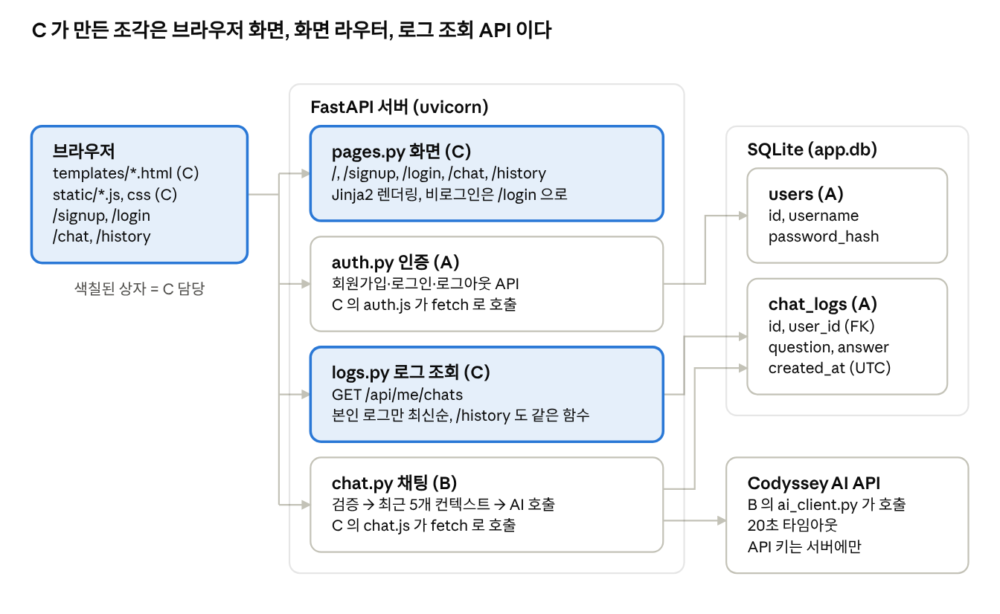

# C 역할 작업 설명서 — UI·로그 조회·배포·문서

작성 @ADOHI (Claude Code 사용) · 2026-10-12 내보냄

> 이 문서는 발표 준비용으로 작성한 원본을 Markdown 으로 내보낸 것입니다. 커밋·PR·테스트 수는 2026-10-10 배포 시점(커밋 `5b5751c`) 기준이며, 이후의 문서 커밋은 반영하지 않았습니다.

Codyssey AI 챗봇 팀 프로젝트에서 C(@ADOHI)가 만든 것을 코드와 함께 설명하는 문서입니다. 코드 발췌마다 GitHub 의 해당 줄로 가는 링크를 달았습니다. 링크는 커밋 고정 주소라 PR 이 머지된 뒤에도 그대로 열립니다.

## 1. 한눈에 보기

C 는 **사용자가 직접 보고 만지는 부분**을 맡았습니다. A 의 인증 API 와 B 의 채팅 API 는 JSON 만 주고받으므로, 그 위에 화면 5개와 JS 를 얹고, 저장된 로그를 확인하는 수단 4가지(API·화면·관리자 페이지·SQL)와 배포 설정, README 를 만들었습니다. 기능 PR 9개와 릴리스 PR 4개, 커밋 29개, 테스트 25개입니다. 배포 주소는 https://codyssey-ai-chatbot.onrender.com 입니다.

| PR | 브랜치 | 커밋 | 만든 것 | 과제 요구사항 |
| --- | --- | --- | --- | --- |
| [#21](https://github.com/Codyssey-AI-Chatbot/Codyssey-AI-Chatbot/pull/21) | `feature/base-ui` | 4 | 공통 레이아웃·CSS, 회원가입·로그인 페이지, 페이지 테스트 5개 | 1 웹 UI, 2 인증 화면 연동 |
| [#22](https://github.com/Codyssey-AI-Chatbot/Codyssey-AI-Chatbot/pull/22) | `feature/chat-ui` | 3 | 채팅 화면, 전송 JS, 로딩·오류 말풍선, 테스트 2개 | 1 웹 UI, 2 접근 제어, 5 오류 안내 |
| [#23](https://github.com/Codyssey-AI-Chatbot/Codyssey-AI-Chatbot/pull/23) | `feature/log-view` | 4 | `GET /api/me/chats`, `/history` 화면, 최근 대화 복원, SQL 스크립트, 테스트 8개 | 4 로그 조회, DB 확인 가이드 |
| [#24](https://github.com/Codyssey-AI-Chatbot/Codyssey-AI-Chatbot/pull/24) | `feature/deploy` | 2 | `render.yaml` Render 배포 설정 | 6 배포, 민감정보 관리 |
| [#25](https://github.com/Codyssey-AI-Chatbot/Codyssey-AI-Chatbot/pull/25) | `docs/readme` | 4 | README 13개 절, `docs/team-roles.md` 담당자 | 최종 결과물 문서, 7 팀 역할 요약 |
| [#28](https://github.com/Codyssey-AI-Chatbot/Codyssey-AI-Chatbot/pull/28) | `fix/render-health-timeout` | 1 | 첫 배포 타임아웃 대응으로 `--loop asyncio` 추가. 원인이 아니어서 #34 에서 되돌림 | 6 배포 |
| [#30](https://github.com/Codyssey-AI-Chatbot/Codyssey-AI-Chatbot/pull/30) | `docs/deploy-url` | 1 | 외부 접속 확인 후 README 에 배포 URL 기입 | 6 배포 |
| [#32](https://github.com/Codyssey-AI-Chatbot/Codyssey-AI-Chatbot/pull/32) | `feature/admin-log-view` | 7 | 관리자 조회 페이지 `/admin`, `ADMIN_PASSWORD` 설정, 테스트 9개 | 4 관리자 조회 화면, DB 확인 가이드 |
| [#34](https://github.com/Codyssey-AI-Chatbot/Codyssey-AI-Chatbot/pull/34) | `fix/render-manual-deploy` | 3 | `--loop asyncio` 되돌리기, 수동 배포 안내로 문서 정정, 관리자 테스트 보완 | 6 배포 |
| [#27](https://github.com/Codyssey-AI-Chatbot/Codyssey-AI-Chatbot/pull/27), [#29](https://github.com/Codyssey-AI-Chatbot/Codyssey-AI-Chatbot/pull/29), [#33](https://github.com/Codyssey-AI-Chatbot/Codyssey-AI-Chatbot/pull/33), [#35](https://github.com/Codyssey-AI-Chatbot/Codyssey-AI-Chatbot/pull/35) | `develop` → `main` | 0 | 릴리스 PR. 머지 커밋만 있음 | 7 main/develop 분리 |

소유 파일은 `app/templates/*`, `app/static/*`, `app/routers/pages.py`, `app/routers/logs.py`, `scripts/*`, `render.yaml`, `README.md`, `tests/test_pages.py`, `tests/test_logs.py` 입니다. 관리자 페이지를 만들면서 templates/admin.html 과 tests/test\_admin.py 가 더해졌습니다. A·B 의 파일은 관리자 비밀번호 설정을 위해 A 의 app/config.py 에 필드 한 줄을 추가한 것 말고는 고치지 않았고, B 코드에서 찾은 문제는 [이슈 #20](https://github.com/Codyssey-AI-Chatbot/Codyssey-AI-Chatbot/issues/20) 으로 전달했습니다.



색칠된 세 상자(브라우저 화면, `pages.py`, `logs.py`)와 그림 밖의 `render.yaml`, README, 테스트 25개가 C 의 결과물입니다. 나머지 상자는 A·B 가 만들었고 C 는 `fetch` 로 호출만 합니다.

## 2. 화면 뼈대와 인증 페이지 (PR #21)

설계의 한 줄: **서버는 HTML 만 그리고, 검증과 인증 판단은 A 의 API 에 맡긴다.** 그래서 `pages.py` 는 템플릿 이름만 고르고, 입력 검사나 비밀번호 처리 코드가 한 줄도 없습니다.

### 화면 라우터 `app/routers/pages.py`

```python
templates = Jinja2Templates(directory=TEMPLATES_DIR)
router = APIRouter(include_in_schema=False)  # 화면은 Swagger(/docs) 목록에서 제외


@router.get("/")
def index() -> RedirectResponse:
    """첫 화면은 채팅 페이지. 비로그인 상태면 /chat 의 의존성이 /login 으로 보낸다."""
    return RedirectResponse("/chat", status_code=302)


@router.get("/login", response_class=HTMLResponse)
def login_page(request: Request) -> HTMLResponse:
    # 회원가입 직후에는 /login?signup=1 로 들어오므로 완료 안내를 함께 보여 준다.
    return templates.TemplateResponse(
        request, "login.html", {"signed_up": "signup" in request.query_params}
    )
```

→ [pages.py L23–L44](https://github.com/Codyssey-AI-Chatbot/Codyssey-AI-Chatbot/blob/a451065/app/routers/pages.py#L23-L44) · `/` 는 `/chat` 으로만 보내고 로그인 판단은 `/chat` 의 의존성에 맡깁니다. 코드를 줄이려고 일부러 그렇게 했습니다.

### 공통 레이아웃 `app/templates/base.html`

```html
<header class="topbar">
  <a class="brand" href="/">Codyssey AI 챗봇</a>
  <nav class="nav">
    
      <a href="/chat">채팅</a>
      <a href="/history">내 대화 기록</a>
      <span class="nav-user">{{ user.username }}</span>
      <button type="button" id="logout-button" class="button-link">로그아웃</button>
    
      <a href="/login">로그인</a>
      <a href="/signup">회원가입</a>
    
  </nav>
</header>
```

→ [base.html L10–L24](https://github.com/Codyssey-AI-Chatbot/Codyssey-AI-Chatbot/blob/a451065/app/templates/base.html#L10-L24) · 로그인 상태에 따라 메뉴가 바뀝니다(요구사항 2 "인증 상태에 따른 기능 구분"). 로그아웃 버튼은 [L29–L37](https://github.com/Codyssey-AI-Chatbot/Codyssey-AI-Chatbot/blob/a451065/app/templates/base.html#L29-L37) 의 작은 스크립트가 `POST /api/auth/logout` 을 부른 뒤 `/login` 으로 보냅니다. 다른 페이지는 `` 로 본문만 채웁니다.

> 이후 변경: 이 로그아웃 스크립트는 다른 JS 와의 일관성을 위해 [`app/static/logout.js`](../app/static/logout.js) 로 분리했습니다(PR #37). `base.html` 은 로그인한 화면에서만 `<script src="/static/logout.js">` 로 불러옵니다. 위 링크는 분리 전 코드입니다.

### 폼 공통 스크립트 `app/static/auth.js`

회원가입·로그인 폼은 HTML 에 `data-api`(호출할 API)와 `data-next`(성공 시 이동 경로)만 적으면 이 스크립트 하나가 둘 다 처리합니다.

```html
<form data-api="/api/auth/signup" data-next="/login?signup=1" novalidate>   <!-- signup.html -->
<form data-api="/api/auth/login"  data-next="/chat" novalidate>            <!-- login.html -->
```

```js
const response = await fetch(form.dataset.api, {
  method: "POST",
  headers: { "Content-Type": "application/json" },
  body: JSON.stringify(body),
});
if (response.ok) {
  window.location.assign(form.dataset.next);
  return;
}
const data = await response.json().catch(() => null);
errorBox.textContent = data?.message ?? `요청에 실패했습니다. (HTTP ${response.status})`;
```

→ [auth.js L25–L36](https://github.com/Codyssey-AI-Chatbot/Codyssey-AI-Chatbot/blob/a451065/app/static/auth.js#L25-L36) · 실패하면 A 의 API 가 준 `{"error", "message"}` 의 `message` 를 그대로 폼 위에 보여 줍니다. 예: "이미 사용 중인 아이디입니다." 비밀번호 확인란은 [L15–L21](https://github.com/Codyssey-AI-Chatbot/Codyssey-AI-Chatbot/blob/a451065/app/static/auth.js#L15-L21) 에서 화면에서만 비교하고 서버로는 보내지 않습니다.

### 스타일 `app/static/style.css`

색상 변수(`:root`), 상단 바, 카드형 폼, 입력·버튼, 알림 메시지 순서로 108줄이고, 이후 PR 에서 채팅과 기록 표 스타일을 덧붙였습니다. → [style.css](https://github.com/Codyssey-AI-Chatbot/Codyssey-AI-Chatbot/blob/a451065/app/static/style.css) · 프레임워크 없이 CSS 한 파일입니다.

확인 방법: `/signup` 에서 가입 → "회원가입이 완료되었습니다" 안내가 있는 `/login` → 틀린 비밀번호로 오류 문구 확인 → 정상 로그인 시 `/chat` 으로 이동.

## 3. 채팅 화면 (PR #22)

설계의 한 줄: **폼 제출 없이 JS 가 B 의 `POST /api/chat` 을 부르고, 응답을 같은 화면의 말풍선으로 붙인다.** 성공·실패 응답 형식은 팀이 첧날 합의한 것을 그대로 씁니다.

### 보호된 라우트

```python
@router.get("/chat", response_class=HTMLResponse)
def chat_page(request: Request, user: User = Depends(get_current_user_or_redirect)) -> HTMLResponse:
    """채팅 화면. 비로그인 사용자는 A 의 의존성이 /login 으로 보낸다."""
    return templates.TemplateResponse(request, "chat.html", {"user": user})
```

→ [pages.py L46–L49](https://github.com/Codyssey-AI-Chatbot/Codyssey-AI-Chatbot/blob/a451065/app/routers/pages.py#L46-L49) · `Depends(get_current_user_or_redirect)` 한 줄이 요구사항 2 의 "챗봇은 로그인 사용자만"입니다. 비로그인이면 303 으로 `/login` 에 갑니다.

### 마크업 `app/templates/chat.html`

```html
<div id="messages" class="messages" aria-live="polite">
  <p class="messages-empty">궁금한 것을 물어보세요. 최근 대화 5개를 기억하고 이어서 답합니다.</p>
</div>

<form id="chat-form" class="composer" novalidate>
  <textarea id="message" name="message" rows="2" maxlength="2000" required
            placeholder="메시지를 입력하세요 (Enter 전송, Shift+Enter 줄바꿈)"></textarea>
  <button id="send-button" class="button" type="submit">전송</button>
</form>
```

→ [chat.html L5–L15](https://github.com/Codyssey-AI-Chatbot/Codyssey-AI-Chatbot/blob/a451065/app/templates/chat.html#L5-L15) · `maxlength="2000"` 은 B 의 서버 제한과 같은 값입니다. 화면은 먼저 막고 서버가 최종 검증합니다.

### 전송과 응답 처리 `app/static/chat.js`

```js
async function sendMessage(message) {
  appendBubble("user", message);
  const loading = appendBubble("assistant", "답변을 생성하는 중…");
  setPending(true);                       // 입력창·버튼 잠금

  try {
    const response = await fetch("/api/chat", {
      method: "POST",
      headers: { "Content-Type": "application/json" },
      body: JSON.stringify({ message }),
    });

    if (response.status === 401) {        // 세션 만료
      window.location.assign("/login");
      return;
    }

    const data = await response.json().catch(() => null);
    loading.remove();

    if (response.ok && data?.answer) {
      appendBubble("assistant", data.answer);
    } else {
      appendError(
        data?.message ?? "요청을 처리하지 못했습니다. 잠시 후 다시 시도해 주세요.",
        data?.error ?? `HTTP_${response.status}`,
      );
    }
  } catch {
    loading.remove();
    appendError("서버에 연결할 수 없습니다. 네트워크 상태를 확인해 주세요.", "NETWORK_ERROR");
  } finally {
    setPending(false);
  }
}
```

→ [chat.js L33–L68](https://github.com/Codyssey-AI-Chatbot/Codyssey-AI-Chatbot/blob/a451065/app/static/chat.js#L33-L68) · 한 함수에 요구사항 세 개가 들어 있습니다. 같은 화면 응답 표시(1), 세션 만료 시 로그인으로(2), 사용자에게 오류 안내(5).

```js
// 오류 말풍선: 안내 문구 뒤에 에러 코드를 붙여 사용자가 문의할 때 전달할 수 있게 한다.
function appendError(message, code) {
  const bubble = appendBubble("error", `${message} `);
  const codeTag = document.createElement("code");
  codeTag.textContent = `(error: ${code})`;
  bubble.appendChild(codeTag);
}
```

→ [chat.js L19–L24](https://github.com/Codyssey-AI-Chatbot/Codyssey-AI-Chatbot/blob/a451065/app/static/chat.js#L19-L24) · 화면에는 "AI 응답이 지연되고 있습니다. 잠시 후 다시 시도해 주세요. (error: AI\_TIMEOUT)" 처럼 나옵니다. 과제 문서의 에러 응답 예시와 같은 형태입니다.

Enter 는 전송, Shift+Enter 는 줄바꿈입니다([L82–L87](https://github.com/Codyssey-AI-Chatbot/Codyssey-AI-Chatbot/blob/a451065/app/static/chat.js#L82-L87)). 빈 입력은 서버에 보내지 않고 화면에서 바로 `INVALID_MESSAGE` 말풍선을 띄웁니다([L70–L80](https://github.com/Codyssey-AI-Chatbot/Codyssey-AI-Chatbot/blob/a451065/app/static/chat.js#L70-L80)).

확인 방법: 가짜 AI 클라이언트를 주입해 정상 답변, `AI_TIMEOUT`, `AI_SERVICE_ERROR`, 빈 입력 네 경로를 브라우저에서 확인했습니다. 실제 키로는 `.env` 의 `AI_TIMEOUT_SECONDS=0.01` 로 타임아웃을 재현할 수 있습니다.

## 4. 로그 조회 API·화면·SQL (PR #23)

설계의 한 줄: **조회 함수는 하나, 출구는 세 개.** `list_user_chat_logs` 가 "로그인 사용자의 로그만 최신순"을 책임지고, API 와 화면이 그 함수를 나눠 씁니다. SQL 스크립트는 운영자용으로 전체 사용자를 봅니다. 과제의 "DB 확인 가이드(아래 중 1개 이상)" 세 가지를 모두 채웠습니다.

### 조회 API `app/routers/logs.py`

```python
def list_user_chat_logs(db: Session, user_id: int, *, limit: int, offset: int = 0) -> list[ChatLog]:
    """사용자 한 명의 대화 로그를 최신순으로 반환한다."""
    statement = (
        select(ChatLog)
        .where(ChatLog.user_id == user_id)
        .order_by(ChatLog.created_at.desc(), ChatLog.id.desc())
        .limit(limit)
        .offset(offset)
    )
    return list(db.scalars(statement))


@router.get("/chats", response_model=list[ChatLogOut])
def my_chats(
    limit: int = Query(DEFAULT_LIMIT, ge=1, le=MAX_LIMIT, description="가져올 개수"),
    offset: int = Query(0, ge=0, description="건너뛸 개수 (페이지 이동용)"),
    user: User = Depends(get_current_user),
    db: Session = Depends(get_db),
) -> list[ChatLog]:
    """내 대화 로그 조회. 다른 사용자의 로그는 user_id 조건으로 조회되지 않는다."""
    return list_user_chat_logs(db, user.id, limit=limit, offset=offset)
```

→ [logs.py L41–L61](https://github.com/Codyssey-AI-Chatbot/Codyssey-AI-Chatbot/blob/a451065/app/routers/logs.py#L41-L61) · `user.id` 는 요청 파라미터가 아니라 세션에서 나온 값이라 다른 사람 id 를 넣어 볼 수 없습니다. `limit` 은 1\~100, `offset` 은 0 이상만 받고 벗어나면 FastAPI 가 422 를 돌려줍니다.

```python
def as_utc(value: datetime) -> datetime:
    """SQLite 는 시간대를 저장하지 않아 naive 로 읽히므로, 저장 기준인 UTC 를 다시 붙인다."""
    return value if value.tzinfo is not None else value.replace(tzinfo=timezone.utc)
```

→ [logs.py L23–L38](https://github.com/Codyssey-AI-Chatbot/Codyssey-AI-Chatbot/blob/a451065/app/routers/logs.py#L23-L38) · 응답의 `created_at` 이 `2026-10-08T07:14:33+00:00` 처럼 UTC 임을 명시합니다. 이게 없으면 브라우저가 현지 시간으로 오해합니다.

### 내 대화 기록 화면 `/history`

```python
@router.get("/history", response_class=HTMLResponse)
def history_page(
    request: Request,
    user: User = Depends(get_current_user_or_redirect),
    db: Session = Depends(get_db),
) -> HTMLResponse:
    """내 대화 기록 화면. API 와 같은 조회 함수를 쓰고, 시각만 KST 문자열로 바꿔 넘긴다."""
    logs = [
        {
            "id": log.id,
            "question": log.question,
            "answer": log.answer,
            "created_at": as_utc(log.created_at).astimezone(KST).strftime("%Y-%m-%d %H:%M:%S"),
        }
        for log in list_user_chat_logs(db, user.id, limit=HISTORY_PAGE_SIZE)
    ]
    return templates.TemplateResponse(request, "history.html", {"user": user, "logs": logs})
```

→ [pages.py L52–L70](https://github.com/Codyssey-AI-Chatbot/Codyssey-AI-Chatbot/blob/a451065/app/routers/pages.py#L52-L70) · 템플릿 [history.html L14–L31](https://github.com/Codyssey-AI-Chatbot/Codyssey-AI-Chatbot/blob/a451065/app/templates/history.html#L14-L31) 은 `` 로 표를 그리고, 로그가 없으면 "아직 대화가 없습니다" 를 보여 줍니다. 최근 50건만 보여 주고 페이지네이션은 일부러 넣지 않았습니다(`HISTORY_PAGE_SIZE` 주석).

### 채팅 화면의 최근 대화 복원

```js
// 화면을 열면 최근 대화를 불러와 이어서 볼 수 있게 한다. (AI 가 기억하는 범위도 이 안에 있다)
async function loadRecentHistory() {
  const response = await fetch("/api/me/chats?limit=20").catch(() => null);
  if (!response?.ok) return;
  const logs = await response.json();
  logs.reverse().forEach(({ question, answer }) => {
    appendBubble("user", question);
    appendBubble("assistant", answer);
  });
}
```

→ [chat.js L90–L100](https://github.com/Codyssey-AI-Chatbot/Codyssey-AI-Chatbot/blob/a451065/app/static/chat.js#L90-L100) · 같은 API 를 화면도 소비하므로 API 가 "평가용"이 아니라 실제로 쓰이는 기능입니다.

### 확인용 SQL `scripts/check_logs.sql` 과 실행기 `check_logs.py`

```sql
-- 1) 최근 대화 로그 20건: 누가, 언제, 무엇을 물었고 어떤 답을 받았는지
SELECT
    c.id,
    u.username,
    c.created_at,
    substr(c.question, 1, 60) AS question,
    substr(c.answer, 1, 60)   AS answer
FROM chat_logs AS c
JOIN users AS u ON u.id = c.user_id
ORDER BY c.created_at DESC, c.id DESC
LIMIT 20;
```

→ [check\_logs.sql](https://github.com/Codyssey-AI-Chatbot/Codyssey-AI-Chatbot/blob/a451065/scripts/check_logs.sql) · 두 번째 질의는 사용자별 대화 수와 마지막 대화 시각입니다(L23–L32). `sqlite3 -header -column app.db < scripts/check_logs.sql` 로 실행합니다.

```python
def run_sql_file(db_path: str, sql_path: Path = SQL_FILE) -> list[tuple[list[str], list[tuple]]]:
    """주석을 제외한 SQL 문을 세미콜론 단위로 실행해 (컬럼명 목록, 행 목록) 쌍을 순서대로 돌려준다."""
    lines = sql_path.read_text(encoding="utf-8").splitlines()
    sql = "\n".join(line for line in lines if not line.lstrip().startswith("--"))
    results = []
    with sqlite3.connect(db_path) as conn:
        for statement in filter(None, (part.strip() for part in sql.split(";"))):
            cursor = conn.execute(statement)
            columns = [description[0] for description in cursor.description or []]
            results.append((columns, cursor.fetchall()))
    return results
```

→ [check\_logs.py L12–L22](https://github.com/Codyssey-AI-Chatbot/Codyssey-AI-Chatbot/blob/a451065/scripts/check_logs.py#L12-L22) · Windows 처럼 `sqlite3` 명령이 없는 환경에서 `python scripts/check_logs.py app.db` 로 같은 SQL 을 돌립니다. 표준 라이브러리만 씁니다. 테스트도 이 함수로 SQL 파일을 검증합니다.

## 4-1. 관리자 조회 페이지 (PR #32)

설계의 한 줄: **DB 구조와 로그인 체계는 그대로 두고, 브라우저 기본 인증 창과 환경 변수 하나로 보호한다.** 배포 환경은 Shell 을 쓸 수 없어 DB 파일을 못 보고, 기존 화면은 본인 대화만 보여 주기 때문에 평가자용 전체 조회 화면을 추가했습니다. 과제 문서가 예로 든 "관리자 조회 API/화면"에 해당합니다.

### 접근 보호 `require_admin`

```python
def require_admin(credentials: HTTPBasicCredentials | None = Depends(_admin_basic)) -> None:
    password = settings.admin_password.get_secret_value() if settings.admin_password else ""
    if not password:
        raise HTTPException(status_code=404)

    # ponytail: 시도 횟수 제한 없음. 길고 무작위인 비밀번호(Render 가 생성)에 의존한다.
    name_ok = credentials is not None and secrets.compare_digest(
        credentials.username.encode(), ADMIN_USERNAME.encode()
    )
    password_ok = credentials is not None and secrets.compare_digest(
        credentials.password.encode(), password.encode()
    )
    if not (name_ok and password_ok):
        raise HTTPException(
            status_code=401,
            detail="관리자 인증이 필요합니다.",
            headers={"WWW-Authenticate": 'Basic realm="admin"'},
        )
```

→ [pages.py L39–L62](https://github.com/Codyssey-AI-Chatbot/Codyssey-AI-Chatbot/blob/5b5751c/app/routers/pages.py#L39-L62) · 세 가지 경우를 나눕니다. `ADMIN_PASSWORD` 가 없으면 페이지 자체를 꺼서 404, 인증이 없거나 틀리면 401 과 `WWW-Authenticate` 헤더(브라우저가 인증 창을 띄움), 맞으면 통과입니다. 사용자명은 `admin` 고정이고, 비교는 `secrets.compare_digest` 로 해서 응답 시간으로 어느 쪽이 틀렸는지 드러나지 않습니다. 일반 사용자 로그인 세션과는 무관합니다.

### 페이지 라우트 `/admin`

```python
@router.get("/admin", response_class=HTMLResponse, dependencies=[Depends(require_admin)])
def admin_page(
    request: Request,
    user_id: int | None = None,
    db: Session = Depends(get_db),
) -> HTMLResponse:
    users = [
        {
            "id": user.id,
            "username": user.username,
            "created_at": kst_text(user.created_at),
            "chat_count": chat_count,
            # 해시 원문은 보여 주지 않고 방식 이름만 꺼낸다. 예: "$argon2id$v=19$..." -> "argon2id"
            "hash_scheme": user.password_hash.split("$")[1] if user.password_hash.startswith("$") else "알 수 없음",
        }
        for user, chat_count in list_users_with_chat_counts(db)
    ]
    logs = [
        {..., "username": username, "created_at": kst_text(log.created_at), "question": log.question, "answer": log.answer}
        for log, username in list_all_chat_logs(db, limit=ADMIN_PAGE_SIZE, user_id=user_id)
    ]
    return templates.TemplateResponse(request, "admin.html", {...})
```

→ [pages.py L109–L142](https://github.com/Codyssey-AI-Chatbot/Codyssey-AI-Chatbot/blob/5b5751c/app/routers/pages.py#L109-L142) · `?user_id=` 를 주면 한 사용자의 로그만 추립니다. 비밀번호 해시는 원문을 화면에 내보내지 않고 `argon2id` 같은 방식 이름만 뽑아 "평문으로 저장하지 않는다"를 보여 줍니다. 템플릿은 [admin.html](https://github.com/Codyssey-AI-Chatbot/Codyssey-AI-Chatbot/blob/5b5751c/app/templates/admin.html) 이고, 기존 `/history` 의 표 스타일을 그대로 씁니다.

### 전체 조회 함수 `app/routers/logs.py`

```python
def list_all_chat_logs(db: Session, *, limit: int, user_id: int | None = None) -> list[tuple[ChatLog, str]]:
    statement = (
        select(ChatLog, User.username)
        .join(User, User.id == ChatLog.user_id)
        .order_by(ChatLog.created_at.desc(), ChatLog.id.desc())
        .limit(limit)
    )
    if user_id is not None:
        statement = statement.where(ChatLog.user_id == user_id)
    return [(log, username) for log, username in db.execute(statement)]


def list_users_with_chat_counts(db: Session) -> list[tuple[User, int]]:
    statement = (
        select(User, func.count(ChatLog.id))
        .outerjoin(ChatLog, ChatLog.user_id == User.id)
        .group_by(User.id)
        .order_by(User.id)
    )
    return [(user, count) for user, count in db.execute(statement)]
```

→ [logs.py L54–L75](https://github.com/Codyssey-AI-Chatbot/Codyssey-AI-Chatbot/blob/5b5751c/app/routers/logs.py#L54-L75) · `scripts/check_logs.sql` 의 두 질의와 같은 내용을 SQLAlchemy 로 쓴 것입니다. `outerjoin` 이라 대화가 없는 사용자도 0건으로 나옵니다. API 로는 노출하지 않고 관리자 화면만 씁니다.

### 설정과 접속 방법

| 환경 | 주소 | 사용자명 | 비밀번호 |
| --- | --- | --- | --- |
| 배포 | `https://codyssey-ai-chatbot.onrender.com/admin` | `admin` | Render 대시보드 Environment 탭의 `ADMIN_PASSWORD`. Render 가 생성한 값 |
| 로컬 | `http://127.0.0.1:8000/admin` | `admin` | 프로젝트 폴더 `.env` 의 `ADMIN_PASSWORD` |

비밀번호 값은 저장소와 문서에 적지 않습니다. 설정 필드는 [config.py L27](https://github.com/Codyssey-AI-Chatbot/Codyssey-AI-Chatbot/blob/5b5751c/app/config.py#L26-L27) 한 줄이고 A 담당 파일이라 PR 에 사유를 적었습니다. "설정은 한 곳에서만 읽는다"는 팀 규칙을 지키려면 거기에 두어야 했습니다.

## 5. 배포 설정 (PR #24)

설계의 한 줄: **배포에 필요한 모든 것을 파일 하나에 적어 저장소에 두되, 비밀 값만은 밖에 둔다.** Render 에서 New → Blueprint 로 저장소를 고르면 이 파일을 읽어 웹 서비스를 만들고, `main` 브랜치를 배포합니다. 공개 저장소 주소로 연결한 서비스라 push 로는 재배포되지 않고 수동으로 배포합니다.

```yaml
services:
  - type: web
    name: codyssey-ai-chatbot
    runtime: python
    plan: free
    region: singapore
    branch: main
    buildCommand: pip install -r requirements.txt
    startCommand: uvicorn app.main:app --host 0.0.0.0 --port $PORT
    healthCheckPath: /health
    envVars:
      - key: PYTHON_VERSION
        value: 3.10.11          # 로컬 개발·테스트와 같은 버전
      - key: SECRET_KEY
        generateValue: true     # 세션 쿠키 서명 키. Render 가 생성
      - key: ADMIN_PASSWORD
        generateValue: true     # 관리자 페이지(/admin) 비밀번호. Render 가 생성 (사용자명은 admin)
      - key: AI_API_KEY
        sync: false             # 배포 시 대시보드에서 입력
      - key: AI_BASE_URL
        value: https://copa.codyssey.kr/v1
      - key: AI_MODEL
        value: gpt-5.4
      - key: AI_TIMEOUT_SECONDS
        value: "20"
      - key: SESSION_COOKIE_SECURE
        value: "true"           # Render 는 HTTPS 로 서비스하므로 Secure 쿠키 사용
      - key: DATABASE_URL
        value: sqlite:///./app.db
```

→ [render.yaml](https://github.com/Codyssey-AI-Chatbot/Codyssey-AI-Chatbot/blob/5b5751c/render.yaml) (주석 포함 42줄)

| 항목 | 왜 이렇게 |
| --- | --- |
| `branch: main` | 팀 규칙상 `main` 은 배포용. `develop` 에서 릴리스 PR 을 머지한 뒤 수동으로 배포한다 |
| `startCommand` 의 `$PORT` | Render 가 포트를 정해 주입하므로 고정값을 쓰면 안 된다 |
| `healthCheckPath: /health` | A 가 만든 엔드포인트. 새 버전이 여기에 200 을 돌려줘야 교체되고, 그때까지 이전 버전이 계속 응답한다 |
| `SECRET_KEY: generateValue` | 사람이 고르지 않고 Render 가 임의 값을 만들어 저장소에도, 대화에도 남지 않는다 |
| `ADMIN_PASSWORD: generateValue` | 관리자 페이지 비밀번호도 Render 가 256비트 무작위 값으로 만든다. 값은 대시보드의 Environment 탭에서 확인한다 |
| `AI_API_KEY: sync: false` | 값이 저장소에 없다는 선언. Apply 단계에서 입력란이 뜨고 Render 에만 저장된다 |
| `SESSION_COOKIE_SECURE: "true"` | HTTPS 전용 쿠키. 로컬 HTTP 에서는 `.env` 의 `false` 가 쓰인다 |
| `PYTHON_VERSION: 3.10.11` | 로컬에서 테스트를 통과시킨 버전과 같게 맞춘다 |
| `plan: free` | 무료. 15분 미사용 시 잠들고, 잠들거나 재시작·재배포될 때마다 디스크(SQLite)가 초기화된다. Persistent Disk 와 Shell 접속도 쓸 수 없다. README 6절에 주의로 적었다 |

실제 배포는 팀 계정으로 Render 에서 한 번만 연결하면 되고, 절차는 README 6절에 단계별로 있습니다. 배포 후 `https://codyssey-ai-chatbot.onrender.com/health` 가 `{"status":"ok"}` 를 돌려주면 성공입니다.

**Render 대시보드 바로가기.** [codyssey-ai-chatbot 서비스](https://dashboard.render.com/web/srv-db4teg5ckfvc7386rcug) 를 열고 왼쪽 메뉴의 Logs(서버 로그), Events(배포 이력), Environment(환경 변수) 탭을 씁니다. Render 계정으로 로그인해야 열립니다.

**무료 플랜에서 주의할 점.** 서버와 DB(`app.db` 파일)가 같은 컨테이너에 있고, 15분 동안 요청이 없으면 잠들면서 그 파일이 사라집니다. 그래서 배포 URL 에서는 가입 → 채팅 → 기록 조회를 끊지 않고 이어서 보여 주고, 누적 저장과 SQL 스크립트 확인은 로컬 실행에서 보여 줍니다. 과제가 권장한 SQLite 를 유지하려고 이 방식을 택했고, 데이터를 유지해야 하면 `DATABASE_URL` 만 바꿔 PostgreSQL 이나 유료 디스크로 옮길 수 있습니다.

**재배포는 수동입니다.** Render 가 GitHub 연동 없이 공개 저장소 주소로 코드를 가져오기 때문에 `main` 에 push 해도 배포가 시작되지 않습니다. 코드만 바뀌면 서비스의 Manual Deploy, `render.yaml` 이 바뀌면 Blueprint 의 Manual Sync 를 누릅니다. 처음에는 자동 배포된다고 잘못 적었다가, Render 배포 이력에 제 push 가 하나도 없는 것을 보고 고쳤습니다(#34).

**첫 배포 실패의 경위.** 첫 배포는 "Timed out after waiting for internal health check" 로 실패했습니다. Render 로그를 보면 시작 명령이 실행되기까지 11분이 걸렸고 그 뒤 상태 확인 요청이 한 번도 도착하지 않았습니다. 같은 커밋을 같은 설정으로 수동 배포하자 54초 만에 기동해 8초 뒤 통과했습니다. 플랫폼의 일시적 지연이었고, uvloop 을 의심해 넣었던 `--loop asyncio`(#28)는 원인이 아니어서 되돌렸습니다(#34).

## 6. README (PR #25)

설계의 한 줄: **과제 문서 "2. 최종 결과물" 의 README 항목을 빠짐없이 담되, 개인별 작업 요약은 `git log` 에서 세어 적는다.** 723줄, 13개 절이고 다이어그램 3개는 GitHub 가 그려 주는 mermaid 입니다.

→ [README.md 전문](https://github.com/Codyssey-AI-Chatbot/Codyssey-AI-Chatbot/blob/5b5751c/README.md) (배포 URL, 관리자 페이지, 수동 배포 안내까지 반영된 최신 버전)

| 과제가 요구한 항목 | README 절 | 내용 |
| --- | --- | --- |
| 프로젝트 개요 (문제 정의, 타겟 사용자, 핵심 시나리오) | [1](https://github.com/Codyssey-AI-Chatbot/Codyssey-AI-Chatbot/blob/5b5751c/README.md#L27) | 시나리오 5개, 요구사항 7개 ↔ 구현 파일 ↔ 담당자 대응표 |
| 시스템 구조 (아키텍처, 컴포넌트 역할) | [2](https://github.com/Codyssey-AI-Chatbot/Codyssey-AI-Chatbot/blob/5b5751c/README.md#L62) | 아키텍처 flowchart, 채팅 처리 sequence diagram, 컴포넌트 표, 디렉터리 구조 |
| API 명세 (요청/응답 예시) | [3](https://github.com/Codyssey-AI-Chatbot/Codyssey-AI-Chatbot/blob/5b5751c/README.md#L186) | 엔드포인트 표(`/admin` 포함), 에러 코드 10개 표, curl 예시와 JSON 응답 |
| DB 구조 (ERD 또는 테이블/필드) | [4](https://github.com/Codyssey-AI-Chatbot/Codyssey-AI-Chatbot/blob/5b5751c/README.md#L314) | ERD(mermaid), 필드 설명 표 2개, 설계 메모 |
| 배포/실행 방법 (환경 변수 설정 포함) | [5](https://github.com/Codyssey-AI-Chatbot/Codyssey-AI-Chatbot/blob/5b5751c/README.md#L370), [6](https://github.com/Codyssey-AI-Chatbot/Codyssey-AI-Chatbot/blob/5b5751c/README.md#L417), [7](https://github.com/Codyssey-AI-Chatbot/Codyssey-AI-Chatbot/blob/5b5751c/README.md#L492) | 로컬 실행 명령, Render 절차·수동 재배포·무료 플랜 주의사항·리눅스 systemd 대안, 환경 변수 9개 표 |
| 민감정보 관리 (.env 예시, .gitignore) | [8](https://github.com/Codyssey-AI-Chatbot/Codyssey-AI-Chatbot/blob/5b5751c/README.md#L512) | 8가지 조치 (관리자 페이지 보호 포함) |
| 운영 (로그, 예외, 입력 검증) | [9](https://github.com/Codyssey-AI-Chatbot/Codyssey-AI-Chatbot/blob/5b5751c/README.md#L525) | 로그 이벤트 예시와 표, 예외 처리 표, 입력 검증 표 |
| DB 확인 가이드 | [10](https://github.com/Codyssey-AI-Chatbot/Codyssey-AI-Chatbot/blob/5b5751c/README.md#L578) | 네 가지 방법: API, 화면, SQL 스크립트, 관리자 페이지 |
| 팀 구성원 역할 및 개인별 작업 요약 | [11](https://github.com/Codyssey-AI-Chatbot/Codyssey-AI-Chatbot/blob/5b5751c/README.md#L638) | 역할 표 + A·B·C 각자 PR 별 커밋 수와 내용 |
| (요구사항 7) 브랜치·PR·커밋 규칙 | [12](https://github.com/Codyssey-AI-Chatbot/Codyssey-AI-Chatbot/blob/5b5751c/README.md#L678) | 브랜치 전략, PR 규칙, 커밋 규칙, 이슈 |
| 테스트 | [13](https://github.com/Codyssey-AI-Chatbot/Codyssey-AI-Chatbot/blob/5b5751c/README.md#L708) | 파일별 개수와 확인 내용, AI 모킹 방식 |

개인별 작업 요약(11절)은 이렇게 썼습니다. 각 사람의 PR 번호, 브랜치, 커밋 수와 그 PR 이 넣은 것을 `git log` 와 PR 목록에서 그대로 옮겼습니다. 그래서 퍼실이 "문서가 Git 이력과 모순되지 않는가"를 대조해도 바로 맞습니다. 예를 들어 B 는 "PR #14 feature/logging-errors (3 커밋): request\_id 기반 이벤트 로그, 504/502/500 응답과 롤백, 민감정보 비노출 테스트" 식입니다.

함께 고친 파일: [docs/team-roles.md](https://github.com/Codyssey-AI-Chatbot/Codyssey-AI-Chatbot/blob/e5093c5/docs/team-roles.md) 의 담당자 행에 비어 있던 B(@Wattamelon), C(@ADOHI)를 채웠습니다. A 가 만든 파일이지만 문서는 C 담당이라 PR 본문에 이유를 적었습니다.

## 7. 테스트 25개

설계의 한 줄: **A 가 만든 `client` 픽스처(임시 DB + 새 쿠키)를 그대로 쓰고, 화면은 상태 코드와 HTML 내용으로, API 는 JSON 으로, SQL 은 실제 파일을 실행해서 확인한다.** 실행은 `python -m pytest -q` 이고 전체 54개 중 25개가 C 의 것입니다.

### `tests/test_pages.py` (7개)

| 테스트 | 확인하는 것 |
| --- | --- |
| [test\_index\_redirects\_to\_chat](https://github.com/Codyssey-AI-Chatbot/Codyssey-AI-Chatbot/blob/a451065/tests/test_pages.py#L4-L8) | `/` 가 302 로 `/chat` 에 간다 |
| [test\_signup\_page\_renders\_form](https://github.com/Codyssey-AI-Chatbot/Codyssey-AI-Chatbot/blob/a451065/tests/test_pages.py#L11-L17) | `/signup` 이 HTML 이고 `data-api="/api/auth/signup"` 폼이 있다 |
| [test\_login\_page\_renders\_form](https://github.com/Codyssey-AI-Chatbot/Codyssey-AI-Chatbot/blob/a451065/tests/test_pages.py#L20-L25) | `/login` 폼, 가입 안내는 기본적으로 없다 |
| [test\_login\_page\_shows\_signup\_notice](https://github.com/Codyssey-AI-Chatbot/Codyssey-AI-Chatbot/blob/a451065/tests/test_pages.py#L28-L32) | `/login?signup=1` 이면 "회원가입이 완료되었습니다" 가 보인다 |
| [test\_static\_stylesheet\_is\_served](https://github.com/Codyssey-AI-Chatbot/Codyssey-AI-Chatbot/blob/a451065/tests/test_pages.py#L35-L39) | `/static/style.css` 가 `text/css` 로 제공된다 |
| [test\_chat\_page\_redirects\_anonymous\_user\_to\_login](https://github.com/Codyssey-AI-Chatbot/Codyssey-AI-Chatbot/blob/a451065/tests/test_pages.py#L50-L54) | 비로그인 `/chat` 은 303 `/login` |
| [test\_chat\_page\_renders\_for\_logged\_in\_user](https://github.com/Codyssey-AI-Chatbot/Codyssey-AI-Chatbot/blob/a451065/tests/test_pages.py#L57-L64) | 로그인 후 `/chat` 은 200, 폼과 사용자명이 있다 |

### `tests/test_logs.py` (8개)

| 테스트 | 확인하는 것 |
| --- | --- |
| [test\_my\_chats\_requires\_login](https://github.com/Codyssey-AI-Chatbot/Codyssey-AI-Chatbot/blob/a451065/tests/test_logs.py#L43-L47) | 비로그인은 401 `UNAUTHORIZED` |
| [test\_my\_chats\_returns\_only\_own\_logs\_newest\_first](https://github.com/Codyssey-AI-Chatbot/Codyssey-AI-Chatbot/blob/a451065/tests/test_logs.py#L50-L63) | 다른 사용자 로그를 섮어 넣어도 내 것만, 최신순, `created_at` 은 UTC 표기 |
| [test\_my\_chats\_supports\_limit\_and\_offset](https://github.com/Codyssey-AI-Chatbot/Codyssey-AI-Chatbot/blob/a451065/tests/test_logs.py#L66-L73) | `limit=2&offset=1` 이 4번·3번째를 돌려준다 |
| [test\_my\_chats\_rejects\_out\_of\_range\_limit](https://github.com/Codyssey-AI-Chatbot/Codyssey-AI-Chatbot/blob/a451065/tests/test_logs.py#L76-L80) | `limit=0`, `limit=101` 은 422 |
| [test\_history\_page\_redirects\_anonymous\_user\_to\_login](https://github.com/Codyssey-AI-Chatbot/Codyssey-AI-Chatbot/blob/a451065/tests/test_logs.py#L83-L87) | 비로그인 `/history` 는 303 `/login` |
| [test\_history\_page\_lists\_my\_logs\_in\_kst](https://github.com/Codyssey-AI-Chatbot/Codyssey-AI-Chatbot/blob/a451065/tests/test_logs.py#L90-L100) | 내 질문·답변이 표에 있고 UTC 00:01 이 `09:01:00` 으로 보이며 남의 로그는 없다 |
| [test\_history\_page\_shows\_empty\_state](https://github.com/Codyssey-AI-Chatbot/Codyssey-AI-Chatbot/blob/a451065/tests/test_logs.py#L103-L109) | 로그가 없으면 "아직 대화가 없습니다" |
| [test\_check\_logs\_sql\_lists\_recent\_logs\_with\_username](https://github.com/Codyssey-AI-Chatbot/Codyssey-AI-Chatbot/blob/a451065/tests/test_logs.py#L112-L126) | `check_logs.sql` 을 실제 실행해 첫 질의에 사용자명·최신 질문이, 두 번째에 건수 2가 나온다 |

### `tests/test_admin.py` (10개)

| 테스트 | 확인하는 것 |
| --- | --- |
| [test\_admin\_page\_is\_disabled\_without\_password](https://github.com/Codyssey-AI-Chatbot/Codyssey-AI-Chatbot/blob/5b5751c/tests/test_admin.py#L43-L50) (2개) | `ADMIN_PASSWORD` 가 없거나 빈 문자열이면 404. 로컬 `.env` 값에 영향받지 않게 미설정 상태를 직접 만든다 |
| [test\_admin\_page\_requires\_basic\_auth](https://github.com/Codyssey-AI-Chatbot/Codyssey-AI-Chatbot/blob/5b5751c/tests/test_admin.py#L53-L57) | 인증 없이 열면 401 과 `WWW-Authenticate: Basic` |
| [test\_admin\_page\_rejects\_wrong\_credentials](https://github.com/Codyssey-AI-Chatbot/Codyssey-AI-Chatbot/blob/5b5751c/tests/test_admin.py#L60-L67) (3개) | 틀린 비밀번호, 틀린 사용자명, 빈 비밀번호 모두 401 |
| [test\_admin\_page\_is\_not\_opened\_by\_a\_normal\_login](https://github.com/Codyssey-AI-Chatbot/Codyssey-AI-Chatbot/blob/5b5751c/tests/test_admin.py#L70-L77) | 일반 사용자로 로그인해도 401 |
| [test\_admin\_page\_lists\_all\_users\_and\_logs\_without\_exposing\_hashes](https://github.com/Codyssey-AI-Chatbot/Codyssey-AI-Chatbot/blob/5b5751c/tests/test_admin.py#L80-L97) | 사용자 3명과 모든 로그가 최신순·KST 로 보이고, 해시 원문과 salt 는 페이지에 없다 |
| [test\_admin\_page\_filters\_by\_user](https://github.com/Codyssey-AI-Chatbot/Codyssey-AI-Chatbot/blob/5b5751c/tests/test_admin.py#L100-L109) | `?user_id=` 로 한 사용자의 로그만 나온다 |
| [test\_admin\_page\_shows\_empty\_state](https://github.com/Codyssey-AI-Chatbot/Codyssey-AI-Chatbot/blob/5b5751c/tests/test_admin.py#L112-L117) | 사용자와 로그가 없을 때의 안내 문구 |

```bash
python -m pytest -q                       # 54 passed
python -m pytest -q tests/test_pages.py tests/test_logs.py tests/test_admin.py   # C 부분만, 25 passed
```

테스트는 임시 디렉터리의 별도 SQLite 파일을 쓰므로 내 `.env` 와 `app.db` 를 건드리지 않고, AI 는 부르지 않습니다(로그 조회와 화면은 AI 가 필요 없습니다). JS 동작은 자동 테스트에 없고, 가짜 AI 클라이언트를 주입한 서버로 브라우저에서 직접 확인했습니다.

## 8. 링크 모음

파일 링크는 브랜치 마지막 커밋에 고정해 두어 브랜치가 지워져도 열립니다. 머지 후 최신 코드는 `develop` 브랜치에서 보면 됩니다.

**PR 과 이슈**

| PR | 연결 이슈 | 브랜치 (마지막 커밋) |
| --- | --- | --- |
| [#21 공통 레이아웃과 회원가입·로그인 페이지](https://github.com/Codyssey-AI-Chatbot/Codyssey-AI-Chatbot/pull/21) | [#15](https://github.com/Codyssey-AI-Chatbot/Codyssey-AI-Chatbot/issues/15) | `feature/base-ui` (`8dfbe09`) |
| [#22 채팅 화면](https://github.com/Codyssey-AI-Chatbot/Codyssey-AI-Chatbot/pull/22) | [#16](https://github.com/Codyssey-AI-Chatbot/Codyssey-AI-Chatbot/issues/16) | `feature/chat-ui` (`57f951a`) |
| [#23 내 대화 로그 조회 API·화면과 DB 확인 SQL](https://github.com/Codyssey-AI-Chatbot/Codyssey-AI-Chatbot/pull/23) | [#17](https://github.com/Codyssey-AI-Chatbot/Codyssey-AI-Chatbot/issues/17) | `feature/log-view` (`a451065`) |
| [#24 Render 배포 설정](https://github.com/Codyssey-AI-Chatbot/Codyssey-AI-Chatbot/pull/24) | [#18](https://github.com/Codyssey-AI-Chatbot/Codyssey-AI-Chatbot/issues/18) | `feature/deploy` (`d4da1a9`) |
| [#25 README 기술 문서](https://github.com/Codyssey-AI-Chatbot/Codyssey-AI-Chatbot/pull/25) | [#19](https://github.com/Codyssey-AI-Chatbot/Codyssey-AI-Chatbot/issues/19) | `docs/readme` (`743bb99`) |
| [#28 Render 상태 확인 타임아웃 대응](https://github.com/Codyssey-AI-Chatbot/Codyssey-AI-Chatbot/pull/28) | [#26](https://github.com/Codyssey-AI-Chatbot/Codyssey-AI-Chatbot/issues/26) | `fix/render-health-timeout` |
| [#30 README 에 배포 URL 기입](https://github.com/Codyssey-AI-Chatbot/Codyssey-AI-Chatbot/pull/30) | [#26](https://github.com/Codyssey-AI-Chatbot/Codyssey-AI-Chatbot/issues/26) | `docs/deploy-url` |
| [#32 관리자 로그 조회 페이지](https://github.com/Codyssey-AI-Chatbot/Codyssey-AI-Chatbot/pull/32) | [#31](https://github.com/Codyssey-AI-Chatbot/Codyssey-AI-Chatbot/issues/31) | `feature/admin-log-view` |
| [#34 --loop asyncio 되돌리기, 재배포 방법 정정](https://github.com/Codyssey-AI-Chatbot/Codyssey-AI-Chatbot/pull/34) | [#26](https://github.com/Codyssey-AI-Chatbot/Codyssey-AI-Chatbot/issues/26) | `fix/render-manual-deploy` |
| 릴리스 [#27](https://github.com/Codyssey-AI-Chatbot/Codyssey-AI-Chatbot/pull/27) · [#29](https://github.com/Codyssey-AI-Chatbot/Codyssey-AI-Chatbot/pull/29) · [#33](https://github.com/Codyssey-AI-Chatbot/Codyssey-AI-Chatbot/pull/33) · [#35](https://github.com/Codyssey-AI-Chatbot/Codyssey-AI-Chatbot/pull/35) | [#26](https://github.com/Codyssey-AI-Chatbot/Codyssey-AI-Chatbot/issues/26) | `develop` → `main` (배포된 커밋 `5b5751c`) |
| (B 에게 전달) | [#20 AI\_API\_KEY 미설정 시 500](https://github.com/Codyssey-AI-Chatbot/Codyssey-AI-Chatbot/issues/20) | - |

**파일 바로가기**

| 영역 | 파일 (배포된 커밋 `5b5751c` 기준) |
| --- | --- |
| 화면 라우터 | [app/routers/pages.py](https://github.com/Codyssey-AI-Chatbot/Codyssey-AI-Chatbot/blob/5b5751c/app/routers/pages.py) |
| 로그 조회 API | [app/routers/logs.py](https://github.com/Codyssey-AI-Chatbot/Codyssey-AI-Chatbot/blob/5b5751c/app/routers/logs.py) |
| 템플릿 | [base.html](https://github.com/Codyssey-AI-Chatbot/Codyssey-AI-Chatbot/blob/5b5751c/app/templates/base.html) · [signup.html](https://github.com/Codyssey-AI-Chatbot/Codyssey-AI-Chatbot/blob/5b5751c/app/templates/signup.html) · [login.html](https://github.com/Codyssey-AI-Chatbot/Codyssey-AI-Chatbot/blob/5b5751c/app/templates/login.html) · [chat.html](https://github.com/Codyssey-AI-Chatbot/Codyssey-AI-Chatbot/blob/5b5751c/app/templates/chat.html) · [history.html](https://github.com/Codyssey-AI-Chatbot/Codyssey-AI-Chatbot/blob/5b5751c/app/templates/history.html) · [admin.html](https://github.com/Codyssey-AI-Chatbot/Codyssey-AI-Chatbot/blob/5b5751c/app/templates/admin.html) |
| 정적 파일 | [style.css](https://github.com/Codyssey-AI-Chatbot/Codyssey-AI-Chatbot/blob/5b5751c/app/static/style.css) · [auth.js](https://github.com/Codyssey-AI-Chatbot/Codyssey-AI-Chatbot/blob/5b5751c/app/static/auth.js) · [chat.js](https://github.com/Codyssey-AI-Chatbot/Codyssey-AI-Chatbot/blob/5b5751c/app/static/chat.js) |
| DB 확인 스크립트 | [scripts/check\_logs.sql](https://github.com/Codyssey-AI-Chatbot/Codyssey-AI-Chatbot/blob/5b5751c/scripts/check_logs.sql) · [scripts/check\_logs.py](https://github.com/Codyssey-AI-Chatbot/Codyssey-AI-Chatbot/blob/5b5751c/scripts/check_logs.py) |
| 테스트 | [tests/test\_pages.py](https://github.com/Codyssey-AI-Chatbot/Codyssey-AI-Chatbot/blob/5b5751c/tests/test_pages.py) · [tests/test\_logs.py](https://github.com/Codyssey-AI-Chatbot/Codyssey-AI-Chatbot/blob/5b5751c/tests/test_logs.py) · [tests/test\_admin.py](https://github.com/Codyssey-AI-Chatbot/Codyssey-AI-Chatbot/blob/5b5751c/tests/test_admin.py) |
| 배포 | [render.yaml](https://github.com/Codyssey-AI-Chatbot/Codyssey-AI-Chatbot/blob/5b5751c/render.yaml) |
| 문서 | [README.md](https://github.com/Codyssey-AI-Chatbot/Codyssey-AI-Chatbot/blob/5b5751c/README.md) · [docs/team-roles.md](https://github.com/Codyssey-AI-Chatbot/Codyssey-AI-Chatbot/blob/5b5751c/docs/team-roles.md) |

**이력 확인 명령**

```bash
git log --oneline --graph --all            # 브랜치와 머지 커밋
git shortlog -sn --no-merges               # 팀원별 커밋 수 (adohi 29, seongon Moon 14, junhnno 13)
git log --oneline --author=adohi           # C 커밋 29개 목록
```

---

관련 문서: [README](../README.md) · [퍼실 문답 예상 Q&A](facilitator-qna.md) · [팀 역할 분담](team-roles.md)
